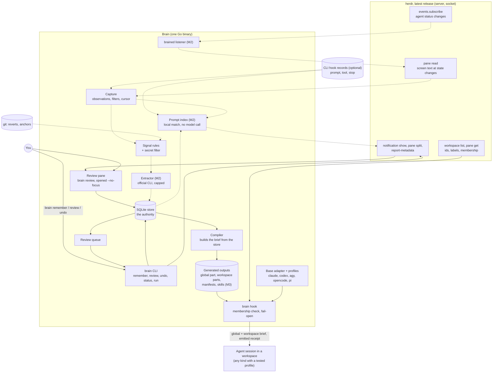
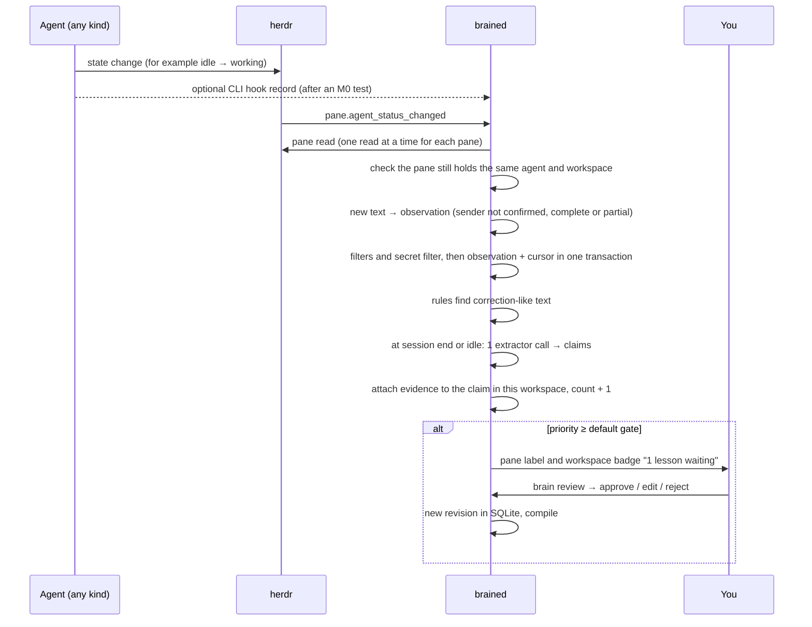
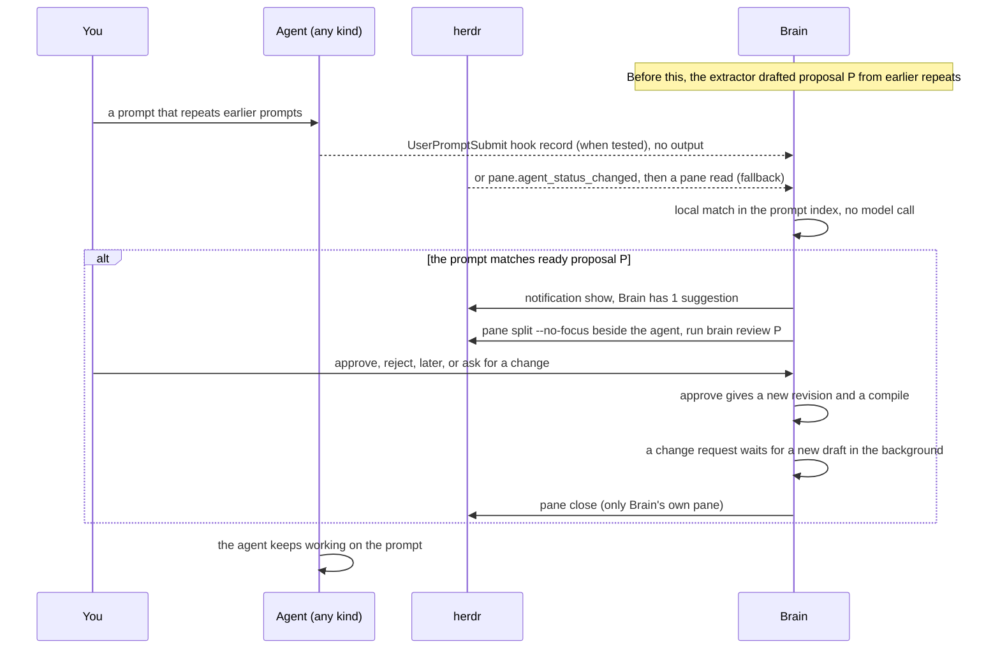

# Brain for herdr: HLD v1.6

- **Status:** v1.6, approved by the owner on 2026-09-27. Implementation is **authorized**, starting with the M0 spike. herdr on this machine: 0.9.1 (protocol 22). M0 results (2026-09-27) are in `herdr-brain/spike/m0/FINDINGS.md` and in §4.2, §8.1 and §17 `[M0]`.
- **Name:** Brain (plugin id `brain`, CLI `brain`). The herdr UI shows "Herdr Brain" (D1).
- **Replaces:** the Drover scope (`docs/research/meta-harness-hld-v4-20260927/HLD.md`, v6.2). Drover is kept as is. §15 lists what Brain takes from Drover.
- **Earlier versions:** `archive/HLD-v1.1.*`, `archive/HLD-v1.2.*`, `archive/HLD-v1.3.*`, `archive/HLD-v1.4.*` and `archive/HLD-v1.5.*`.
- **Changes in v1.6** (from Astra's review of v1.5 `[ASTRA6]`, verdict "accept with changes", findings F1-F11):
  - **Simpler eval isolation.** `brain eval attach`, the `eval_sessions` table, `--store` on normal commands and `--control` are removed. `brain setup` binds each real herdr session to the one main store. Only the test session has its own store. Every `brain` entry point uses one resolver. An unbound session gets nothing and writes nothing (§8.3, §12.1).
  - **Honest G1 claim.** The live check proves that the target pane is live. It does not prove which process called. M0 tests a match with the live agent session (§8.3, §17).
  - **Fresh eval state.** The runner resets the test store before each case. The control is the same case with no seed. Labels are narrower: run status is apart from answer labels, and `leaked` is now `control_pass` (§12.1).
  - **Conflict policy completed.** An unresolved conflict wins over the precedence line. Exception and conflict links are stored on revisions and are part of undo (§7.4, §7.5).
  - **Extraction and forget.** One active batch per session. A forget during extraction discards that batch. Claim text is removable apart from the claim id (§6.7, §7.2, §7.3).
  - **Hook timing and cleanup.** The lookup deadline, the total cap and the receipt rules are separate. Old-generation cleanup is a practical rule, not a guarantee. Forget reports "pending" until old outputs are gone (§7.5, §8.3).
  - **Words.** "herdr session" means a herdr server session. "Agent session id" means the conversation id that herdr reports (§6.2, §11).
  - **Labeled prompt set** replaces the negative set. Skill choice is tested with real agents in M3 (§12.1).
  - **Product for every herdr user (owner rule).** Brain is for any herdr user on herdr 0.9.1 or later, not only the owner. The first use must show the need for Brain. The look-back is a source of probes, not a stop gate. One-person stop rules are gone (§12, §13 "Product bar", D6).
  - **Scope reach (owner rule).** Global items reach every workspace in every bound real herdr session. Workspace items reach every agent session in that workspace. All real herdr sessions share one main store (§1.3, §8.3).
  - **Final review fixes** [ASTRA7]: workspace mappings need a matching root folder and session continuity; review panes are owned per binding; `status` and `doctor` explain an unbound session.
  - 9 new scenarios (S76-S84). S63, S64, S69, S71 and S74 changed. §17 items 10 and 27 extended, items 29-30 new.
- **Changes in v1.5** (from the waku-agent study `[WAKU]` and Astra's report `[ASTRA5]`, gaps G1-G9):
  - **Evals (new §12.1).** Fixture probes check that the agent answers right from a delivered item. Labels: PASS, STALE, INVENTED, MISS, UNSURE and SKIPPED. A control run has no brief. A separate test herdr session keeps evals away from your real store. No score and no judge model.
  - **Delivery needs a live pane (G1).** If herdr does not confirm the calling pane, the hook prints nothing, also no global part. The M4 gateway refuses calls in the same case (§8.3, §10.2).
  - **One generation at a time (G4).** The compiler writes each output generation to its own folder and then switches one pointer. The hook never mixes parts of two generations (§7.5, §8.3).
  - **Workspace exceptions (G2).** You can link a workspace item as an exception to a global item. The brief says which one wins. A workspace item never relaxes a global permission or safety rule (§7.4, §8.1).
  - **Forget covers every derived record (G5).** The prompt index names the filtered prompt text that it keeps for close matches. Forget deletes it (§6.7, §11).
  - **Extraction commits once (G3, M2).** Results and the watermark commit in one transaction, with a stable batch id (§7.3).
  - **False matches (G6, M2-M3).** Close prompt matches stay off until a negative prompt set passes. Skills name their required tools (§5.5, §8.2).
  - **Disputed items look disputed (G7, M3)** in the brief (§9.1).
  - **D12 stays open.** Astra recommends a herdr-gated form only (G8). You decide later (§16).
  - 13 new scenarios (S63-S75). S30 and S49 changed. 2 new M0 checks (§17 items 27-28).
- **Changes in v1.4** (from the owner answers `[OWNER]` in `OWNER_QUESTIONS.md`, and Astra's answers `[ASTRA4]`):
  - **All owner decisions are made** (§16). Runtime: **Go**, one binary. The hook is the `brain hook` subcommand.
  - **Global items also go through the herdr hook.** No native global files by default. One brief with two scope labels, one byte budget and one manifest (§1.3, §8.3).
  - **One base adapter plus a data profile for each harness.** Code overrides only where a profile cannot express the behavior (§8.5).
  - **New targets:** agy (replaces Gemini CLI), OpenCode and pi. Docs are checked. Nothing is tested on this machine (§8.2).
  - **Live suggestions** (new owner requirement): when you repeat a prompt, Brain shows a ready proposal in a small herdr side pane. You approve, reject or ask for a change, and you stay in your session (§5.5).
  - **The TTY rule is removed.** Every `brain remember` makes a draft that you confirm in the herdr UI. No path proves human origin (§5.1, §18).
  - **Optional hook records:** CLI hooks add structured evidence to the herdr capture stream, after an M0 test (§6.1).
  - **Tools are argv recipes** that run through `brain run`. Approval covers the full execution contract (§10.1).
  - **Automation trigger:** one tested "agent stopped working" condition for each CLI, a pinned folder, no backfill. Brain-origin runs are excluded from learning (§10.4).
  - **Scope cuts (D10):** fallback B only if needed; transcript readers only after real evidence loss; `brain status` replaces the weekly digest; M2-M4 stay at direction level. Comebacks keep the item revision.
  - **Extraction is on by default** after setup, with an off switch for each workspace (D9). **Only the latest herdr release** is supported, with a version check (D6).
  - **Closed workspaces:** items stay without delivery. Relink only on request. No forced 90-day prompt (D7).
  - **Owner rule (follow-up): all Brain effects stay inside herdr.** Export to CLI rules files is removed. Global skills stay in Brain's folder and the hook lists them. The MCP gateway shows no tools outside herdr (§1.2).
  - **Live suggestion limits:** the hourly cap and the reject mute are removed. They had no source. §12 measures first (§5.5).
  - The pre-M0 look-back is now 30-60 minutes (§13). 11 new scenarios (S52-S62). §17 marks the facts that M1 needs.
- **Changes in v1.3** (from the Astra review of v1.2 `[ASTRA3]`, verdict "accept with changes"):
  - **Capture gives observations, not turns.** A state change is a chance to read the pane. It does not prove a full user message or a full reply (§6.2).
  - **Count once, for real.** A stable capture identity, one transaction for each observation and its cursor, and transcripts as enrichment only (§6.4).
  - **Workspace checks on writes too.** `remember`, capture, candidates, rejection and the M4 server check live membership. Rejection is per scope (§5.1, §6.2, §7.2, §10.2).
  - **An agent call is not your word.** `brain remember` from an agent makes a draft. Your own terminal or the review popup publishes (§5.1, §6.5).
  - **Safe compile and uninstall.** One compile lock, output generations, hash checks on repair and uninstall. Uninstall removes only an unchanged Brain block (§7.5, §8.1).
  - **Undo and forget have full contracts** (§7.5, §6.7).
  - **Receipts say "emitted", not "verified".** Verified needs the M0/M1 test on a recorded CLI version. A missing receipt means "unknown" (§8.3, §8.5).
  - **Comeback evidence is kept before duplicate drop** (§7.3).
  - **Locality is renamed.** "Strict" becomes **extraction off**. The HLD now says that agents send delivered items to their own cloud model (D9).
  - **One real automation in M4**, with a small binding record and Prime's claim-before-run pattern (§10.4).
  - **A new workspace gets no workspace block until it is mapped.** It never inherits by root folder (§8.3).
  - **Prior art** in products and in code (§2.1, §2.2). **Build weight review** as decision D10 (§16).
  - Smaller fixes: rejection reopens only by your choice, capture exclusion, queue fairness, milestone labels, SkillsBench v4 numbers, D4 without a quota claim, S31-S51.
- **Changes in v1.1:**
  - Brain is stand-alone. It needs only herdr.
  - The two scopes are **global** and **workspace** (a herdr workspace). The "project" scope is removed.
  - Workspace items reach Claude and Codex through a SessionStart hook, not through repo files.
- **Changes in v1.2** (from the Astra review `[ASTRA2]` and the source reads of Omnigent, Flow, amfs and Hermes):
  - **herdr is the capture path for all harnesses.** Brain reads the pane at each agent state change. Transcript readers are an optional extra (§6).
  - **No resident process in M1.** M1 uses short CLI calls and the hook. The herdr listener `brained` comes in M2 (§13).
  - **SQLite is the authority.** Files are generated outputs. Brain builds them again after an interrupted write (§7.5).
  - **Stable claim ids, revisions and evidence cursors.** A repeated event counts once. A stale edit is refused (§7.2, §11).
  - **Strict attribution.** Assistant text cannot create your preference or a permission (§6.5).
  - **Outcome to version.** A failure with revision 1 does not count against revision 2 (§5.4).
  - **Thresholds are configurable priority defaults**, not hard gates (§7.2).
  - **A rejected claim can return** only when new evidence is strong, or when you reset it (§7.2).
  - **Skills default to the workspace scope.** Workspace items and skills live outside repos (§8.2).
  - **Promotion to global is explicit** (§9.3). **Pinned items do not age** (§9.2).
  - **Adapter descriptors** report detection, configuration and verified delivery apart (§4.1, §8.5).
  - **Brain does not read native memory** of Claude or Codex (§7.3).
  - **Locality is honest.** Storage is local. An extractor through an official CLI can use a cloud model. New decision D9.
  - **Measurement uses raw counts and examples**, not percentage targets (§12).
  - Corrections: Hermes aging is 14/30 days. The amfs token cost covers the full memory protocol, not 40 tools alone.
  - Gemini CLI joins the targets table, with M0 checks.
  - 9 new scenarios (S22-S30). S3, S7, S8, S13 and S17 changed.
- **Language:** simple technical English. Short sentences, one idea each.

---

## 0. Summary

1. Brain is a herdr plugin. It helps every coding agent that runs in herdr get better over time. The herdr UI shows it as "Herdr Brain".
2. Brain is **stand-alone** and **harness agnostic**. It needs only herdr. herdr is its main mechanism.
3. Brain keeps context at two levels: **global** (all agents) and **workspace** (all agents in one herdr workspace).
4. Every agent in a workspace can get that workspace's context, no matter who started it. In M1, this works for Claude and Codex. Other CLIs get it when their adapter profile passes its test (§8.5, §18).
5. Brain captures text through herdr: it reads the pane when an agent changes state. This works for every agent kind that herdr knows. The reads are partial evidence, not a full record of the conversation (§6.2). Optional CLI hooks add structured records to the same stream (§6.1).
6. It finds what you repeat: corrections, procedures, prompts, commands and failures. It proposes small items: facts, preferences, decisions, skills, tools and automations.
7. You approve each item. `brain remember` makes a draft, and Brain opens a small review pane beside the caller. When you repeat a prompt, Brain can show a ready proposal in the same kind of pane. You decide there and stay in your session (§5.1, §5.5).
8. Global and workspace items reach each new session through one herdr hook at session start. So one lesson reaches Claude, Codex and every other CLI with a tested profile. The hook delivers only when herdr confirms the live pane, in a herdr session that `brain setup` bound. Brain has no effect on sessions outside herdr (§1.2).
9. SQLite is the single source of truth. Files are built from it and can be built again.
10. Brain proposes and you review. Research shows gains from curated items and losses from some self-generated items (§2). So every learned item needs review and an outcome check.
11. M1 is small: remember, deliver, review, undo, forget. It has no resident process. M2 adds learning from corrections and live suggestions, M3 adds skills, M4 adds tools and automations. M2-M4 stay at direction level until M1 data exists.
12. Success is "the same mistake does not come back", shown with counts and examples. Fixture evals check that a delivered item gives right answers, and no stale or invented answers (§12.1).
13. All Brain data is stored on your machine. Two flows leave it: the extractor's excerpts (on by default after setup, off for a workspace on request), and the items that agents receive, which agents may send to their configured provider (D9).
14. Brain is one Go binary. It is a product for every herdr user on herdr 0.9.1 or later. It refuses older versions, and it warns on a version that it was not tested on (D2, D6).

---

## 1. Goal, scopes and non-goals

### 1.1 Goal

> A smart meta brain, at workspace and global level, for all agentic harnesses that run in herdr.

The owner's pain: each agent session starts cold. You repeat the same facts and corrections. A lesson you give to Codex does not reach Claude. Procedures you explain again and again never become reusable.

The gap is real because each vendor's memory sees only its own CLI. herdr sees all agents.

### 1.2 Design rules

- **Stand-alone.** Brain needs only herdr and the agent CLIs that you already use.
- **Harness agnostic.** Brain captures through herdr, not through one reader per CLI. One base adapter does the shared work. Each harness adds only a small data profile: its hook events, config path and output form (§8.5). An unknown harness still gets capture, with lower confidence.
- **Inside herdr only.** Brain is a herdr plugin. All its effects stay inside herdr sessions. It writes no CLI rules file and no native skill folder. Its hook entries and its MCP server do nothing outside herdr (`HERDR_ENV` is not `1`). `HERDR_ENV=1` alone is not enough: herdr must confirm the live pane (§8.3). [OWNER]
- **Observe and give context only.** Brain does not start, stop, route or prompt agents. It opens only its own review pane beside an agent, without focus, and it closes only that pane. Fallback B (§8.4) is the only case that would type into an agent. It is built only if needed. The eval runner (§12.1) is a test tool, not part of the plugin. It starts and prompts agents only in a separate test herdr session.
- So any agent in a workspace benefits: an agent you start by hand, an agent that a script starts, or an agent that another tool starts.

### 1.3 Two scopes

| Scope | What it holds | Who gets it | Where it lives |
|---|---|---|---|
| **Global** | Your preferences and facts for all work ("use pnpm", "reply in simple English") | Every agent session in every workspace of every bound real herdr session (§8.3), in every CLI with a tested profile | Brain's store; given to each session by the herdr hook, with the workspace part (§8.3). Global skills live in Brain's folder, and the hook lists them (M3). |
| **Workspace** | Facts, decisions, handoffs and procedures for the work in one herdr workspace | Every agent session that starts in a pane of that workspace, in every CLI with a tested profile, at any later time | Brain's store; given to each session by the herdr hook (§8.3) |

- A herdr workspace groups tabs and panes. It has an id (for example `w14`), a label and a root folder (`identity_cwd`).
- One workspace can hold panes in several repos. The workspace scope follows the workspace, not the repo.
- Two workspaces can use the same checkout. Their items stay apart, because delivery uses the workspace id, not the folder.
- A learned item starts in the workspace where Brain saw it. Global scope is always your explicit choice.
- Brain does not read or write per-CLI memory (Claude auto memory, Codex Memories).
- A session outside herdr gets no Brain items. There is no export path. The hook entry stays in the CLI config, but it prints nothing outside herdr.

### 1.4 Non-goals

- No agent start, stop or routing. No prompts, except fallback B, which is built only if needed. Brain never resumes an agent after an automation.
- No automatic apply of learned items, skills, scripts, hooks or automations. Tools and automations never publish without review.
- No learning score, no A/B engine, no replay gate (§2, R6). Evals are pass or fail fixture cases, not a score (§12.1).
- No changes to permissions. Brain can only suggest an allow rule.
- No cloud part of Brain. The store, the hook and all files stay on the machine. The extractor and agent delivery are separate cases (D9).
- No subscription or quota routing. Brain does not know your plans or quotas. That goal stays deferred.
- No token reading, copying or proxying. Only official, unmodified CLIs.
  - The §8.1 hook-file snapshot may hold tokens that the file already holds. Brain never uses or sends them.

---

## 2. Evidence that shapes the design

Sources are in `drover-handoff-20260927/prior-research/self-improving-verdict-20260926/VERDICT.md`, `research/REFERENCE_NOTES.md` and `astra-brain-20260927/`.

| Finding | Source | Design rule |
|---|---|---|
| Curated skills raised aggregate success (33.9% to 50.5%). Three self-generated conditions fell 8.1, 11.3 and 11.5pp below their baselines. The study has confounds. | SkillsBench v4 (arXiv 2602.12670v4), as read in [ASTRA3] | **R1.** Brain proposes. You review. Outcomes check each item. This does not prove that every generated item fails. |
| 39 of 49 skills gave zero gain; 3 made results worse. | SWE-Skills-Bench (arXiv 2603.15401) | **R2.** Few, specific items. Repeats raise the priority of a skill draft. |
| Context files: no success gain, about +20% cost. | arXiv 2602.11988 | **R3.** Hard size budgets. Each byte costs tokens in every session. |
| Scoped, outcome-checked memory helped (utility .713 → .816, 0 harmful accepts in 63). | ASTRA survey P1 | **R4.** Every item has a scope. Items come from observed outcomes. |
| Self-evolving skill libraries poison themselves at 20-42% after one bad item. | EvoMal (arXiv 2608.25776) | **R5.** No automatic tools. Hash pin and approval for every tool. |
| At low task volume, only large effects show up, and only after weeks. | Earlier survey F §5.4 | **R6.** No score. Show the recurrence of targeted mistakes with raw counts and examples. |
| amfs: in one reported experiment, the feedback arm equaled the no-feedback arm (n=97 per arm). The full memory protocol cost 5-7x tokens. That cost was not measured for the tool count alone. | amfs `IMPROVEMENTS.md`; [ASTRA2] correction | **R7.** Observe from outside the agent. Keep the MCP surface small. |
| Corrections, rejections and reverts carry more signal than token counts. | ASTRA survey §6, §10 | **R8.** Corrections are the main signal. |
| Vendors ship memory and improve it each month. | Claude, Codex, Copilot docs | **R9.** Use native hooks. Do not build a second memory system inside a CLI. |
| Flow and amfs keep source attribution, expected revisions, evidence cursors and stable claim ids in code. | [FLOW] `store.ts:330-480`; [AMFS] `lessons.py:1-132`, `evidence.py:695-753` | **R10.** Record who said it, where it came from, and which version was in use. |
| Omnigent separates declared harness abilities from observed abilities. | [OMNI] `harness_capabilities.py`, `tests/harness_bench/README.md` | **R11.** Report detection, configuration and delivery apart. Recognition is not delivery. |
| waku-agent keeps facts with no review, no dedup and no staleness check. Its memory arena grades each answer as pass, stale, invented or miss, and compares with a contestant that has no memory. Its own fixture says that it shows the format only. | [WAKU] `waku/memory/semantic/store.py:71`, `waku/ops/memory_arena.py:231`, `:455`, `evals/memory_arena.json`; [ASTRA5] §3 | **R12.** Test answers, not only receipt. Fixture probes with separate labels for stale and invented answers, and a control with no brief. No score. |

### 2.1 Prior art in products

The main idea already works in real products. No product found joins all of Brain's parts. This check used public pages on 2026-09-27. It did not test the products.

| Product | What it does like Brain | Difference |
|---|---|---|
| GitHub Copilot Memory (public preview 2026-01, on by default for Pro in 2026-03) | Learns facts from agent work. Stores code citations and checks them before use. Deletes unused facts after 28 days. Scoped to one repository. | GitHub agents only. The agent saves memory with no review. Repository scope, not workspace scope. |
| Claude Code auto memory and skills; Codex `AGENTS.md`; Cursor and Windsurf memories | Memory inside one CLI | A lesson in one CLI does not reach another |
| Memorix, agentmemory, memsearch, Mem0 OpenMemory MCP, cross-agent-memory (open source); BuildBetter CLI (commercial) | One memory shared across many CLIs, through MCP or Markdown files | The agent must call a tool, or each CLI needs a reader. No terminal capture. Scope is the repository. |
| Waku (`ShenSeanChen/waku-agent`): an open-source local assistant; "Waku Memory" is a hosted MCP service (not in the reviewed checkout) | One memory for several agents through MCP. Local SQLite facts with keyword search, episodes and skills. | The cross-harness part is a hosted service. The agent writes facts with no review. The local store has no dedup, merge or staleness check. |
| Rule-sync tools (for example `ruler`, `rulesync`; not checked on 2026-09-27) | Build `CLAUDE.md` and `AGENTS.md` from one source | They copy rules that you write. They do not learn. |

What Brain adds: capture through herdr for any CLI, scope by live herdr workspace, a review queue, and comeback checks. These parts carry most of the build risk. Before M1, check if a memory layer above can serve as a delivery path (§17 item 19).

### 2.2 Mechanisms that Brain reuses at code level

These are open-source projects. Brain reads their source for patterns. It runs none of their code.

| Project | Mechanisms Brain uses | Where |
|---|---|---|
| Flow (`samyakkkk/flow`) | Source attribution, expected revisions, evidence cursor, strict attribution, one-time permission apart from a lasting rule, exact session binding, handoff notes, "always-on" bar, separate health checks | R10, §6.4, §6.5, §7.4, §7.5, §8.3, §8.5, §9.3, §11 |
| Omnigent (`omnigent-ai/omnigent`) | Declared versus observed abilities, injected-text filters, lazy skill loading, `block_sha256`, original-byte snapshots, log secret filter, firm tool descriptions | R11, §6.3, §6.7, §8.1, §8.2, §8.5, §10 |
| Prime Intellect (`PrimeIntellect-ai/prime-agent`) | Refinement records (plan, check, apply, roll back). Claim-before-run and dispatch records for scheduled jobs. A `doctor` command (a small precedent only). | §7.5, §10.4, §4.1 |
| amfs | Stable claim id apart from wording; outcome tied to the version in use | §7.2, §5.4 |
| Hermes Agent | Pins, recoverable archive, skill patches, 14/30-day aging (Brain uses longer defaults) | §9.2 |
| dsh-continual-harness | Ownership check before an edit. Brain's exact `brain:begin` marker is Brain's own design. | §8.1 |
| waku-agent (`ShenSeanChen/waku-agent`) | Eval method: pass, stale, invented and miss labels; a control with no memory; a flag for probes that pass without memory; negative prompts for skill triggers; model-call counters in offline tests; Unicode-safe query tests. An empty result is not an unavailable capability. | §5.5, §7.3, §8.5, §12.1 |

---

## 3. Features and their sources

Each feature names the source of its idea. The tags are defined in §19. **[NEW]** means that no outside source had the idea: it is a Brain design choice. **[OWNER]** means the idea came from you.

### 3.1 Remember and scopes (M1)

| Feature | Source |
|---|---|
| Two scopes: global and workspace | [OWNER] workspace and global level (2026-09-27); [D] Drover §8 global and project scopes; [ASTRA] P1 "Scope Before You Persist" |
| Global and workspace facts, preferences and decisions | [S2] `CLAUDE.md`, [S3] `AGENTS.md`; [D] Drover §8 |
| Task handoff as a workspace item subtype (goal, decisions, checks, blockers, next step) | [FLOW] handoff notes; [ASTRA2] "a task handoff is a workspace memory subtype" |
| `brain remember "…"` makes a draft. Brain opens its review pane beside the caller; one key publishes. An agent call is never your word. | [S5] Devin Knowledge (person-written entries); [ASTRA3] F4; [OWNER] confirm in the herdr UI |
| The brief tells agents to run `brain remember` when you ask them to remember something; a brief with a skill tells them that a correction of a skill step needs no `brain remember` | [OWNER] 2026-10-07, #253 (D15); 2026-10-10, #373 |
| Scope from a live membership check of the calling pane (workspace by default, `--global` for global) | [H] `herdr pane get`; [ASTRA3] F3 "resolve membership before workspace writes" |
| Every agent in a workspace gets its context, no matter who started it | [OWNER] "all the agents it invokes in a specific workspace would benefit"; [H] hook env carries `HERDR_WORKSPACE_ID` |
| Global and workspace items reach each session through one herdr hook at session start, with no repo files | [OWNER] D8; [DOC] Codex hooks `SessionStart` `additionalContext` (`codex-rs/hooks/src/schema.rs`); [DOC] Claude Code SessionStart hooks; [M] `~/skills/tldraw-offline/inject-server-context.sh` |
| Live membership check before delivery. When herdr does not confirm the live pane, the whole brief is withheld. | [ASTRA2] "pane movement and stale environment values require a live membership check"; [FLOW] exact session binding; [ASTRA5] G1 |
| No effect outside herdr: no export, no native global files, no native skill folders | [OWNER] D8 and the follow-up rule "all effects stay inside herdr" |
| One base adapter plus a data profile for each harness; code overrides only where a profile cannot express the behavior | [OWNER] D3a; [H] `herdr integration install` covers claude, codex, pi, opencode, antigravity-cli and others |
| One Go binary; the hook is `brain hook` | [OWNER] D2 |
| herdr version check; herdr 0.9.1 or later is supported | [OWNER] D6, changed in v1.6 |
| Workspace identity that survives restarts and renames | [M] `~/.config/herdr/session.json` keeps `id` and `identity_cwd`; [H] `workspace list`; [NEW] the matching rule |
| Decisions stored with the reason | [D] Drover §8.2 item types (`decision` type) |
| SQLite as the authority; files built from it | [ASTRA2] "use SQLite as the authority and regenerate versioned outputs" |
| One output generation in one folder, switched by one atomic pointer; the hook never mixes generations | [ASTRA5] G4; [WAKU] `waku/memory/__init__.py:166` writes a direct Markdown mirror with no consistency check; [NEW] the pointer |
| A workspace item can be an exception to a global item, linked in review | [ASTRA5] G2; [NEW] the link and the precedence line |
| Expected revision on every edit | [FLOW] `store.ts:378` revision conflict check |

### 3.2 Learn from corrections (M2)

| Feature | Source |
|---|---|
| Capture through herdr for every agent kind: read the pane at each agent state change; store bounded observations | [OWNER] "harness agnostic, herdr as the main mechanism"; [H] `pane.agent_status_changed`, `pane.read`; [ASTRA3] F1; [NEW] the read method |
| Optional CLI hook records (`UserPromptSubmit`, `PostToolUse`, `Stop`) join the herdr stream, after an M0 test | [OWNER] D11; [ASTRA4] §B; [DOC] Codex `dispatcher.rs` |
| "Sender not confirmed" mark on captured text | [H] herdr has no event for typed input, so it cannot show who typed; [NEW] the mark |
| Strict attribution: assistant text cannot create your preference or a permission | [FLOW] `curation/prompt.ts` attribution rules; [ASTRA2] scenario 4 |
| Filter for injected text and compaction summaries | [OMNI] `session_import/local.py:449-465`, `:557-568` |
| Corrections, rejections and reverts as the main signal | [ASTRA] §6 and §10; [V] "one trigger"; [PR] "make overrides, corrections, failed checks and rejects the main learning path" |
| A plain-words lesson ("remember", "from now on", "always", "never") from herdr capture gets a proposal after the first session (gate 1) | [OWNER] 2026-10-07, #253 (D15) |
| Configurable priority defaults for repeats (correction 2, failure 2, procedure 3) | [V] assumption A1; [ASTRA2] "treat repeats as supporting evidence and queue-priority signals" |
| Cross-harness count: a Codex correction and a Claude correction count as one pattern | [V] "only the cross-harness part is still open"; [H] herdr sees all 22 agent kinds; [NEW] the counting method |
| Stable claim id, apart from the wording and the revision | [AMFS] `lessons.py:1-132`; [R] amfs A12 |
| Evidence cursor: one source event counts once, also after a retry | [FLOW] `coordinator.ts` durable cursor; [ASTRA2] scenario 1 |
| Failure signature repeats and git reverts | [ASTRA] §6; [V] option 1 trigger list |
| Propose, never apply alone | [S5] Devin; [S10] curated skills help, self-generated do not; [HERMES] approval is optional there, so Brain makes it the rule |
| A rejected claim stays rejected in its scope. Brain shows new evidence since the rejection. Only you reopen it. | [ASTRA2] "allow reconsideration after changed evidence or explicit owner action"; [ASTRA3] F12 |
| Only real outcomes and your verdict count as evidence | [R] amfs A11 `verified_by`; [PR] |
| Outcome tied to the revision that the session got | [AMFS] `models.py:1010-1070`, `test_outcome_credits_the_claim_read.py` |
| Extractor: one headless call per session to the official CLI that you pick, daily cap, on by default after setup | [D] Drover red lines; [OWNER] D4, D9; [NEW] batching and caps |
| Live suggestion: at a repeated prompt, a ready proposal opens in a small herdr side pane; local match, no model call | [OWNER] 2026-09-27; [H] `notification show`, `pane split --no-focus`; [NEW] the prompt index |
| Exact prompt matches first; close matches only after a negative prompt set passes | [WAKU] `evals/deterministic/test_skill_triggers.py`; [ASTRA5] G6 |
| The prompt index names the filtered text that it keeps; forget deletes it | [ASTRA5] G5 |
| An extraction batch commits its results and the watermark in one transaction, with a stable batch id | [ASTRA5] G3; [WAKU] `waku/memory/consolidation.py:71` |
| herdr listener `brained` from M2, not M1 | [ASTRA2] "a permanent process before there is work for it"; [H] socket `events.subscribe` |
| Transcript readers only if M0 or later use shows consequential evidence loss | [OWNER] D5, D10; [H] hooks report `agent_session` and `transcript_path`; [OMNI] session import |

### 3.3 Skills (M3)

| Feature | Source |
|---|---|
| A procedure you explain again becomes a skill draft (priority default: 3) | [S14] Hermes background skill review; [S9] 39 of 49 skills had zero gain |
| You edit and approve every skill | [S10] SkillsBench; [S13] EvoMal |
| Skills are workspace by default; global only when you choose it | [ASTRA2] "default learned items to their source workspace, including skills" |
| Workspace skills live in Brain's folder, not in repos. The hook lists them. | [ASTRA2] "keep workspace artifacts outside repositories"; [OMNI] `load_skill.py:147-175` lazy loading |
| Global skills also live in Brain's folder. The hook lists them in the global part. | [OWNER] effects stay inside herdr; [OMNI] `load_skill.py:147-175` lazy loading |
| Few skills, kept small | [F] §1.5: most authored skills are never used |
| Each skill names its required tools and one example. Skills are tested together, with negative prompts. | [WAKU] `evals/deterministic/test_skill_triggers.py:108`; [ASTRA5] G6 |

### 3.4 Upkeep (M3)

| Feature | Source |
|---|---|
| Stale-fact check from git anchors | [D] Drover §8 git anchors; [S4] Copilot checks code citations |
| A disputed item shows a disputed mark in the brief | [ASTRA5] G7; [WAKU] stale answers as a separate label, `waku/ops/memory_arena.py:231` |
| Archive candidates in `brain status` for items with no relevant session in 90 days; no forced prompt | [OWNER] D7; [HERMES] `curator.py`: stale at 14 days, archive at 30 days (Brain uses longer defaults, because a working fact is invisible); [S4] Copilot 28-day expiry |
| Pinned items never age. Retired items can be restored. | [HERMES] `curator.py` pin protection and archive |
| Size budget in bytes for each block | [S7] AGENTS.md study; [R] dsh growth cap (#3); [ASTRA2] "use a size budget rather than a line-count limit alone" |
| Promotion from workspace to global only when you ask, with the Flow "always-on" bar as a check | [ASTRA2] "keep global promotion explicit"; [FLOW] `orient-doc.ts:8-20` |
| Items of a closed workspace stay, without delivery; relink only on your request | [OWNER] D7 |
| Comeback tracking per revision: a lesson that fails twice gets a rewrite proposal | [V] exit test; [AMFS] outcome to version; [OWNER] D10 keeps the revision; [NEW] the rewrite trigger |

### 3.5 Control (M1; live suggestions in M2)

| Feature | Source |
|---|---|
| One review queue; each proposal is a diff with source, sender and scope | [V] option 1; [ASTRA2] "one queue for every artifact type" |
| Plan → check → apply → rollback, with before and after content | [R] dsh and prime refinement (#1); [R] dsh baseline check (#2) |
| Brain writes only its own files; in a hook config it adds one entry and removes only an unchanged entry | [R] dsh ownership checks (#12); [OMNI] `UNINSTALL_DESIGN.md:63-82` `block_sha256` (Brain hashes the entry) |
| Original-byte snapshot before the first edit of a shared file; uninstall is a dry run by default | [OMNI] `UNINSTALL_DESIGN.md:274-300` |
| Adapter descriptor for each harness: detected, configured, delivery verified | [OMNI] `harness_capabilities.py`, `harness_availability.py`; [FLOW] `agent-setup.ts` separate health checks |
| Warning in review when an item changes a permission or a safety rule | [FLOW] one-time permission versus continuing preference; [ASTRA2] scenario 4 |
| Pane label for waiting proposals; the review pane opens only for a `remember` call or a matching prompt | [H] `herdr pane report-metadata`; [NEW] the choice to interrupt only there |
| Review pane `brain review <id>`, opened `--no-focus` beside the agent; Brain closes only its own pane | [OWNER] confirm in the herdr UI; [H] `pane split`, `pane close` |
| Workspace badge (item count, waiting proposals) | [H] `herdr workspace report-metadata --source --token` |
| `brain status` with counts and examples, in place of a weekly digest | [OWNER] D10; [V] assumption A2 |
| `brain learn off` switch | [R] amfs A14 no-feedback arm; [PR] |
| Evals: fixture probes in a separate test herdr session, labels for stale and invented answers, a control with no brief (§12.1) | [WAKU] `waku/ops/memory_arena.py:231`, `:455`, `:626-634`; [ASTRA5] §3.3; [NEW] the test-session isolation |
| `brain status` and `brain doctor` | [R] prime `doctor` lists processes (#7), a small precedent; [NEW] capture and delivery checks; [ASTRA2] "do not silently repair configuration" |

### 3.6 Tools, automations and the gateway (M4)

| Feature | Source |
|---|---|
| Tools that every agent can call through one shared schema | [OWNER] idea from 2026-09-27 |
| A gateway with 4 fixed tools instead of one MCP tool per learned tool | [NEW] the 4-tool shape; [ASTRA2] "fixed entrypoints bound advertised schemas" |
| Firm tool descriptions for `recall` and `remember` | [OMNI] `hindsight.py:141-147` |
| Gateway shows the tools of the agent's workspace plus global tools | [H] `HERDR_WORKSPACE_ID` in the pane env |
| Tools are argv recipes in `tool.toml`, run through `brain run` in the agent's shell, under the CLI's permission prompt | [OWNER] tool form; [ASTRA4] §D; [ASTRA2] "a generic approved MCP invocation does not establish per-action permission enforcement" |
| Contract hash: approval covers command bytes, input schema, scope, cwd, timeout and effects. A change stops the tool until you approve it again. | [S13] EvoMal; [F] §1.10 Bad Memory; [ASTRA4] §D |
| Usage log for every tool call | [F] §1.5 |
| Script, hook and allow-rule suggestions, never installed alone | [V] Phase 1; [NEW] suggestion only |
| One approved automation: one tested "stopped working" trigger, one pinned folder, one tool, claim-before-run; Brain-origin runs are excluded from learning | [OWNER] automations are required, trigger decision; [ASTRA4] §E; [PRIME] `cron-jobs.ts:718-742`, `:1749-1795` due-job claims and dispatch records; [ASTRA3] F10 |

### 3.7 Across all features

| Feature | Source |
|---|---|
| herdr capture for all harnesses; optional hook records; transcripts only after real loss | [OWNER] D5, D11; [H] |
| Secret filter before storage and before any LLM call | [D] Drover §10.1; [OMNI] `process_logging.py:108-118` |
| No learning score | [ASTRA] §8; [F] §5.4 |
| Extraction on by default after setup, with an off switch for each workspace; setup explains both data flows | [OWNER] D9; [ASTRA2] "official local CLIs can still send input to cloud models"; [ASTRA3] F9 agent delivery |
| Capture exclusion for a workspace or a pane | [ASTRA3] F13 |

---

## 4. Architecture

Solid lines exist from M1. Dotted lines come later (M2-M4) or are optional.



### 4.1 Components

All components are parts of one Go binary and one plugin manifest. They are not separate services.

| Component | Job | Milestone |
|---|---|---|
| `herdr-plugin.toml` | Binds actions (review, remember, status) and the popup to the `brain` binary. From M2 a `[[startup]]` entry starts `brained` once for each herdr session. herdr runs `[[startup]]` only after a session restore, so after `herdr plugin install` the build starts the `start` action: it starts `brained` and opens setup when the session has no binding (E19-S3). | M1 |
| `brain` binary | One Go binary (D2). Short calls: `remember`, `review`, `undo`, `forget`, `pin`, `learn`, `status`, `doctor`, `hook` and `setup`. `setup --session <name>` binds one more real herdr session to the main store. `setup --session <name> --test <folder>` binds a test session to its own store (§8.3). `promote` comes in M3. `run`, `tools` and `automation` come in M4. `update [--check]` (E19-S4) reinstalls a managed plugin or pulls and builds a linked checkout on `main`, then runs `doctor --fix`; it is the only command that uses the network. Each call checks the herdr version and refreshes the workspace map and the labels. | M1 |
| Store | SQLite. The only source of truth. M1 creates only the M1 tables (§11). | M1 |
| Compiler | Builds one output generation in its own folder: the global part, one workspace part for each workspace and one manifest. Then it switches one pointer. Runs under one lock. Skill folders come in M3. | M1 |
| `brain hook` | The hook subcommand. It checks the live pane with herdr, reads the current generation once and prints the brief in the output form of the profile. It then writes an "emitted" receipt. OpenCode and pi call it through a small shared TypeScript shim. | M1 |
| Base adapter + profiles | Shared code for all harnesses, plus one data profile for each harness (§8.5) | M1 for Claude and Codex; others after M0 |
| Review queue and review pane | Holds proposals until you decide. `brain review <id>` can run in a small pane that Brain opens `--no-focus` beside the caller. | M1 |
| Recall popup | The plugin action `brain.recall` opens a herdr popup for the workspace of the focused pane (E20-S3). You type words; it lists the items, skills and tools that `brain recall` gives that pane (§8.6), with their scope, and Enter shows one of them with its source excerpts through the secret filter (§7.4). It only reads: no recall record, no decision; for a change it shows `brain review --item <id>`. | E20 |
| `brained` listener | Runs as the plugin `[[startup]]` process, one for each herdr session (lock in the plugin state dir). After an install, the build starts it through the `start` action (E19-S3); the same lock keeps one copy. When its binary file changes (`brain update`, a reinstall or a new build), it drops the lock and runs the new binary in its place, with no herdr restart (E19-S4). Exits when the event socket closes or Brain is disabled or unlinked. Subscribes to herdr events for each pane. Reads panes at state changes. Runs the extractor and the prompt match for herdr capture. | M2 |
| Capture | Turns each pane read and each hook record into a bounded observation. Filters injected text, adds the sender mark, moves the cursor in the same transaction. | M2 |
| Signal rules | Find candidate corrections, procedures, repeated prompts, command chains and failures. No LLM. | M2 |
| Extractor | Turns a batch of signals into claims and ready proposals | M2 |
| Prompt index | Normalized earlier prompts and the ready proposals that they lead to. Local match, no model call. | M2 |
| Transcript readers | Built only after real evidence loss (D5) | not planned |
| `brain run` and tool registry | Runs approved `tool.toml` recipes with checks (§10.1) | M4 |
| MCP gateway | 4 fixed tools over the tool registry. Optional. | M4 |
| Automation runner | Part of `brained`. Runs one approved tool for one bound trigger, with claim-before-run | M4 |
| Eval runner | A test tool in the Brain repo, not part of the plugin. It runs the §12.1 probes and the §8.5 conformance test in a separate test herdr session. | M0 (delivery), M1 |

### 4.2 herdr facts used (checked on 2026-09-27)

Checked on this machine against the running server (`ping` → `"version":"0.8.2","protocol":20`). The minimum version is now 0.9.1, so M0 checks every fact below again on 0.9.1. M0 facts on 0.9.1 (protocol 22) carry the tag `[M0]`.

**Version policy (D6):** Brain supports herdr 0.9.1 or later. `brain setup` and each `brain` call refuse an older version with a clear message. Brain keeps a list of tested versions: 0.9.1 and each later release that passed the conformance test and the eval delivery and exclusion stages. On a newer untested version, `brain status` warns and Brain keeps working. A failed fact makes the hook withhold, never guess. The hook does not check the version, so that it stays inside its time cap. It fails closed when a herdr answer has an unknown shape.

**Agents and sessions**
- `herdr agent list` gives the agent kind, pane, `cwd`, state and `agent_session` (agent session id) for each agent. herdr knows 22 agent kinds.
- Pane ids include the workspace (for example `w14:p3`). A pane that moves gets a new id.
- Agent states are `idle`, `working`, `blocked`, `done` and `unknown`.
- The herdr integration hooks report the agent session id. The Claude hook also sends `transcript_path`. Installed here: `claude` v8, `codex` v8, `opencode` v10.
- `herdr integration install` supports claude, codex, pi, opencode, antigravity-cli and other CLIs. Brain uses these hooks as the reference for event names and config paths in its profiles. It does not change them.
- 3 of 19 live agents had no agent session id (`null`). Brain must work without it.

**Reading panes**
- `pane read` and `agent read` return plain text. Sources: `visible`, `recent`, `recent-unwrapped`, `detection`.
- Rows that leave an alternate screen do not enter the host scrollback. A later read cannot get them back.
- herdr has no event for typed input. It cannot show who typed a message: you, a script or another tool.

**Workspaces**
- `herdr workspace list` gives `workspace_id` (for example `w14`), `label` and `number`. It does not give a folder. On 0.9.1, a plugin action gets `workspace_cwd` in `HERDR_PLUGIN_CONTEXT_JSON` `[M0]`. `session.json` also stores `identity_cwd`.
- Workspace ids are per herdr session: a new named session starts again at `w1` `[M0]`. After a restart, herdr restores the same ids with the same `identity_cwd`. After a deletion of session state, herdr reuses `w1` for a new workspace in another folder `[M0]`. herdr has no persistent session identity: `session.json` has no session id `[M0]`. So the continuity rule of §8.3 uses the (herdr session, workspace id) pair and the project folder check of §11 only: the saved `identity_cwd` must be the recorded project folder or lie beneath it (owner decision 2026-09-28).
- `HERDR_SESSION` is set only in panes of a named session. A pane of the default session has no `HERDR_SESSION`, so Brain reads "not set" as `default` `[M0]`.
- herdr puts `HERDR_ENV`, `HERDR_WORKSPACE_ID`, `HERDR_PANE_ID` and `HERDR_SOCKET_PATH` in each pane. The agent CLI and its hooks inherit them.
- `~/.config/herdr/session.json` stores `id`, `custom_name` and `identity_cwd` for each workspace of the default herdr session. Workspace ids stay the same after a herdr restart. This file is an internal format (§17). For another herdr session, Brain uses the `session_dir` from `herdr session list --json`, or no root folder. It never uses the default file for another session.
- `herdr session list --json` gives `name`, `default`, `running`, `session_dir` and `socket_path` for each herdr session. `herdr --session <name>` uses or creates a named session.
- `herdr workspace report-metadata <id> --source ID --token NAME=VALUE --ttl-ms` sets tokens on a workspace.

**Events and UI**
- The socket method `events.subscribe` takes `{"subscriptions":[{"type":…}]}`. Types include `pane.agent_detected`, `pane.agent_status_changed`, `pane.exited`, `pane.closed` and `pane.output_matched`.
- `herdr pane report-metadata` sets pane labels.
- `herdr notification show` (socket `notification.show`) shows a message. It has no reply and no action. So a notification cannot carry an approve key.
- `herdr pane split --no-focus` opens a pane beside another pane without focus. `herdr pane close` closes a pane. Brain closes only panes that it opened.
- Any process of your user can send keys to any pane. So a keypress in a pane does not prove that you pressed it.
- On 0.8.2, the plugin API was the CLI plus the socket. There is no storage API. The events ring holds 512 entries and does not persist. There is no plugin sidebar.
- **herdr 0.9.1 has a plugin system `[M0]`.** A manifest `herdr-plugin.toml` declares `min_herdr_version`, `[[actions]]`, `[[panes]]` (placement `overlay`, `popup`, `split`, `tab` or `zoomed`), `[[events]]` (for example `workspace.renamed`, `workspace.closed`), `startup` and `build`. `herdr plugin link <path>` installs a local plugin. herdr gives a plugin `HERDR_PLUGIN_STATE_DIR` and `HERDR_PLUGIN_CONFIG_DIR`. Tested: an action got its context in `HERDR_PLUGIN_CONTEXT_JSON`. `herdr plugin pane open --placement split --no-focus --env K=V` opened a split pane without focus, and `herdr plugin pane close` closed it.
- These facts can simplify Brain: review panes as plugin panes, `[[events]]` for part of `brained`, and `workspace_cwd` for the root folder. M1 uses plugin panes for review. The other two are decided in M1, with a written reason.

---

## 5. Main flows

### 5.1 You tell Brain something (M1)

```
you: brain remember "use pnpm, not npm"   (in a pane of workspace w14 "shop")
  → live check: herdr pane get $HERDR_PANE_ID → in w14?   → you can pass --global
      unbound herdr session, or a pane that herdr does not confirm → writes nothing
      another workspace → Brain asks for --workspace or --global, writes nothing
  → SQLite: draft item, claim id, revision 1, origin = remember, sender = unconfirmed
  → Brain opens its review pane beside the caller:
      herdr pane split --no-focus → runs brain review <id>
  → you press a (approve), e (edit), r (reject) or l (later)
  → approve: sender = you (review), state = active; the compiler builds the brief again
  → Brain closes its own review pane
  → the next session in "shop" gets it through the herdr hook
```

- With `--global`, the item goes into the global part of the brief. Then every new session in herdr, in every CLI with a tested profile, gets it.
- `--workspace` and `--global` only choose the scope. They never skip the binding check (§8.3).
- An agent that calls `brain remember` follows the same path. The review pane opens beside that agent. The item stays a draft until you act. The brief tells agents to make this call when you ask them to remember something (§8.1).
- If Brain cannot open the pane (for example, the split fails), the draft waits in `brain review`, and the pane label shows it.
- You can also confirm through the herdr plugin popup or `brain review`. All surfaces use the same queue.
- **Trust boundary:** no path proves human origin. herdr 0.8.2 `notification show` has no reply. Any process of your user can call `brain review` or send keys to the review pane. So review guards against normal agent calls. It is not authentication. Brain does not defend against a hostile process with your user rights.

### 5.2 A new agent starts in a workspace (M1)

```
any agent starts in a pane of workspace w14 (you, a script or another tool started it)
  → the CLI runs its start hook (SessionStart, or the start event in its profile)
  → brain hook --profile codex: HERDR_ENV=1, HERDR_WORKSPACE_ID=w14, HERDR_PANE_ID=w14:p3
  → live check: herdr pane get w14:p3 → a live pane, still in w14?
      no → print nothing, record "withheld" with the reason
      no answer before the lookup deadline → print nothing; no receipt if no time is left ("unknown")
  → reads the pointer to the current output generation, once
  → reads the workspace map → the global part + workspaces/<key>.md + the manifest of that generation
      w14 not in the map (a new workspace) → global part only, record "unmapped"
      a file does not match the manifest → print nothing, record "withheld: inconsistent"
  → prints the brief in the output form of the profile, for example
    {"hookSpecificOutput":{"hookEventName":"SessionStart","additionalContext":"…"}}
  → writes an "emitted" receipt (profile, pane, brief hash, manifest generation, time)
  → the agent starts with the global part + the "shop" part
```

- Outside herdr (`HERDR_ENV` is not `1`), the hook prints nothing.
- If anything fails before the print, the hook prints nothing and exits 0. The session starts as normal.
- If the receipt write fails after the print, the session has the brief. Its delivery status is **unknown**.

### 5.3 Brain learns from a repeat (M2)



### 5.4 A mistake comes back after a lesson (M2)

- The extractor finds a new correction with the same claim id as an active item. Brain keeps this evidence before it drops the duplicate proposal (§7.3).
- The evidence must be new and valid. The model's `same_as` guess alone is not proof. An uncertain match is stored as **uncertain**.
- Brain checks the receipts for that session (emitted, unmapped or withheld). Their manifests name the item revisions. Which revision did the session get?
  - The current revision: Brain records a **comeback** for that revision.
  - An older revision: the comeback counts against the old revision only.
  - No receipt: Brain records **delivery unknown**, not a comeback. It checks the adapter first.
  - A "withheld" receipt: Brain records a **delivery gap**.
- Global items go through the same hook, so their receipts name their revisions too.
- After a resume or a compaction, a session can have several receipts. Brain uses the last receipt before the observation.
- Two comebacks on one revision: Brain proposes a better wording or a stronger place, for example a skill instead of a fact.
- A skill (E20-S5): the extractor links a correction or a tool failure to the active skill that covers it (`covered_by`). It is a comeback of the skill revision that the session got, and it makes no item of its own. Brain counts sessions, not flags: the same failure in two sessions makes one change request, a patch of the skill with a diff (§9.2), not a second skill.
- Delivery does not prove that the agent used the item. Brain does not change the item by itself.

### 5.5 A suggestion at a repeated prompt (M2)

This is a new owner requirement. When you send a prompt that repeats earlier prompts, Brain shows a ready proposal at that moment. The proposal can create or change a lesson, a skill, a tool or an automation. You decide in a small side pane and stay in your session.



- **Drafts first.** The extractor drafts proposals in the background (§7.3). Each ready proposal stores the normalized prompts that led to it.
- **Local match.** At prompt time, Brain normalizes the new prompt and looks it up in the prompt index. Exact repeats match by hash. Close matches stay **off** until the prompt index passes the negative prompt set (§12.1). No source gives a threshold for close text. M2 sets it from that set. There is no model call. Target: under 50 ms.
- **Match reason** (E20-S9): each suggestion stores why it matched, as a kind word with no prompt text: an exact prompt match, or a plain-words lesson (§7.2). The review of the proposal and `brain status` show it in one line. A suggestion of an older Brain shows "unknown".
- **Fastest path:** the `UserPromptSubmit` hook record, for a CLI whose profile has it and where M0 tested it. The hook does the match inside its time cap. On a match, it starts a detached `brain` process that shows the notification and opens the pane. The hook prints nothing, so the prompt does not change.
- **Fallback:** herdr capture at the next state change, through `brained`. It can come some seconds later.
- **Surface:** a herdr notification, and a small review pane `brain review <id>` that Brain opens with `--no-focus` beside the agent. The pane shows the change (the diff, or the full execution contract for a tool or an automation), 1-3 source excerpts and the expected benefit. Brain closes only its own pane.
- **Actions:** approve, reject, later, or ask for a change in a short line of text. A change request goes to the extractor. The new draft comes back later as a new proposal. It does not block the agent.
- **Rules** (defaults, [NEW]):
  - At most one suggestion per prompt, and one review pane per agent at a time.
  - "Later" mutes that proposal for the rest of the session. Else the same pane opens again at each matching prompt.
  - A reject is final in its scope, like every rejection (§7.2).
  - No rate cap. No source supports a number. §12 counts shown, approved, rejected and later suggestions. M2 adds a cap only if that data shows too many.
  - The pane never takes focus. Brain never types into the agent.
  - Tools and automations always need an explicit approve of the full contract. They never publish without review.
  - `live_suggestions = off` in the config, or `brain learn off`, stops them.
- **Timing limit:** the approved change reaches the **next** session start. The current prompt runs without it. A skill file or a tool file is on disk at once, but the current agent does not know about it.
- **Trust limit:** as in §5.1, no path proves human origin.

---

## 6. Observation

### 6.1 Sources

| Source | Harnesses | What it gives | Milestone |
|---|---|---|---|
| `brain remember` | All | Explicit lessons, as drafts that you confirm | M1 |
| **herdr capture** (events + pane reads) | All 22 kinds | Text fragments with no confirmed sender, visible errors, session start and end, blocked states | M2 |
| CLI hook records (optional) | Claude and Codex first; others after their M0 test | The exact submitted prompt, the exact shell command and its result, a stop marker | M2, after an M0 test |
| git | All | Reverts, file changes, anchors | M2 |
| Transcripts | Claude and Codex | Full text when the screen lost rows | Only if needed (D5, §6.6) |

herdr capture is the main path. It needs no code for each harness. Hook records add structure to the same stream. They do not replace capture. Brain works fully without them.

**Hook records** (D11; details from [ASTRA4] §B):
- They use the same `brain hook` binary, with an event name from the profile.
- `UserPromptSubmit`: the exact submitted text. The sender stays **unconfirmed**, because a script or `herdr agent prompt` can also submit text. The hook prints nothing.
- `PostToolUse`: a shell-tool matcher first. Codex gives the session `cwd`, not the command `cwd`. `tool_response` has no standard exit code, and a long command can finish through `write_stdin`. So Brain records an exit status only when the payload has one. Claude sends a failed command to `PostToolUseFailure`, with the exit code in `error`; Brain also matches this event. Claude's `cwd` is the shell cwd after the command.
- `Stop`: an observation only. It does not prove that the reply is complete. Claude's `Stop` payload has `last_assistant_message`, the text of the final reply.
- `PreCompact`: deferred. Its payload has no conversation text.
- Capture hooks are short. They exit 0 on any error and never block the CLI.
- Brain enables a hook event for a CLI only after its M0 test on a recorded CLI version. A newer CLI version keeps the event on, and setup still adds its entry (§8.5, owner decision 2026-10-07, #251).

### 6.2 herdr capture

A state change is a **chance to read** the pane. It does not prove that you sent a message or that the agent finished its reply. The read also comes after the event, not at its exact time.

1. `brained` subscribes only to bound herdr sessions with learning on (§8.3). It subscribes to `pane.created` and `pane.agent_detected`. For each pane it adds `pane.agent_status_changed`, `pane.exited` and `pane.closed` with the `pane_id`, because herdr requires the pane for status events.
2. On **every** status change (also `blocked` → `working` and `unknown`), it reads the pane (`recent-unwrapped`, about 120 lines).
3. Reads are **one at a time for each pane**. When a read returns, Brain checks that the pane still holds the same agent, session and workspace. If not, it drops the read and records a gap.
4. Brain compares the read with the last read of that pane. The last read is kept **in memory only**. The new part becomes one **observation**: (capture identity, event, event time, read time, text, status).
5. Status is `complete`, `partial` or `gap`. A partial or uncertain piece is kept as it is. Brain never invents missing text.
6. **Session key:** (canonical herdr binding, harness, agent session id from herdr) when herdr has the id. Else (canonical herdr binding, harness, local capture id). Brain stores the key before it stores any evidence for it. For Codex, herdr gives the agent session id only after the first prompt of a run (M0 E11-S1b). Before that, Brain uses a local capture id. An agent session id that appears later enriches that session. It does not merge two identities.
7. **Pane moves:** when live membership changes, a new capture segment starts. Brain never joins text across that boundary. New text never goes to the old workspace.
8. **Start and reconnect:** Brain reconciles all live agents. For an agent that already works, the current screen is only a baseline. Brain records a gap and waits for new text.
9. **Exit and close:** Brain closes the segment. It does not need a final read to succeed.

Limits:
- Claude draws in the alternate screen. While it is `working` or `blocked`, only the screen can be read. A longer herdr read at idle scrolls the pane, so Brain does not use it (see below). Codex draws inline, so its rows go to scrollback. `recent-unwrapped` works while Codex is `working` or `blocked` (M0 E11-S1b). The pane history spans Codex runs, so Brain keeps only the new part of a read (step 4) and never joins text across runs.
- For an alternate-screen agent (Claude), herdr can read only the screen. `recent-unwrapped` above the screen size fails with `agent_not_idle` while the agent is `working` or `blocked`. Brain uses the `visible` read for such agents and reports lower coverage. Hook records (§6.1) give the prompt, the commands, the errors and the final reply. The M2 evals measure the loss (D5).
- An observation can hold screen noise, for example the input box. Optional noise patterns for each harness remove it. An unknown pattern lowers confidence. It does not fake a clean text.
- Brain reads only. It never sends keys or scrolls a pane to get missed text. For an alternate-screen agent it reads only `visible`, because a longer herdr read scrolls the pane at idle.

### 6.3 Sender mark and filters

- herdr cannot show who typed a message. So every captured message has the mark **sender not confirmed**.
- `brain remember` text has the mark **sender not confirmed**, because an agent can call it too. Your approval in review sets **sender = you** (§5.1).
- Before the signal rules run, Brain drops text that it or the CLI injected:
  - Brain blocks and hook output (they carry the `brain:begin` marker);
  - CLI scaffolding such as `<environment_context>` and `<skills_instructions>`;
  - compaction summaries. After a compaction, capture starts again from the new screen.
- The same filters apply to hook records and to transcripts.
- **Limits:** pane text has no reliable tags for roles, compaction or injected text. A marker can be lost, and other text can copy it. So the filters lower noise. They do not prove clean text. All excerpts are untrusted data, also when they quote instructions.

### 6.4 Evidence cursor

- **Capture identity:** (session binding, segment, herdr event id when it exists, else read time). Brain's own turn numbers are not part of it.
- One SQLite transaction stores the observation and moves the cursor. A crash leaves both or neither.
- A retry or a duplicate event with a known capture identity does not count again.
- If Brain cannot tell a replay from new evidence, it stores the observation but does **not** raise the support count.
- Two genuine, separate observations with the same text count twice. The same text on a repaint or a resize does not.
- Brain does not assume that herdr can replay events. The events ring does not persist. After a restart, Brain takes a baseline and records the gap (§6.2).
- **Hook records and transcripts:** a hook record (or a transcript record, if a reader exists) that matches a pane observation adds detail to that observation. It is not a second occurrence. Both references are kept. Brain matches by session binding, time window and normalized text.
- Transcript cursors are byte offsets for each file.

### 6.5 Strict attribution

| Sender | Can support | Cannot create |
|---|---|---|
| You (after review approval of a `brain remember` draft or a plain-words lesson proposal, or a review edit) | Any item | — |
| Sender not confirmed (captured message) | A correction, explicit lesson, procedure or fact candidate | Nothing goes live without review |
| Assistant text (agent reply, recap, summary) | Context for a candidate | Your preference, a permission, or a safety rule |
| Tool output (errors) | A failure candidate | A preference or a permission |

- Captured start text is not always your message. End text is not always the agent reply. Brain calls such text **correction-like text** until you confirm it in review.
- A one-time permission in chat ("you can push this time") never becomes a standing rule.
- A candidate that changes a permission or a safety rule gets a warning in review (§7.4).

### 6.6 Transcript readers (only if needed)

- D5: Brain does not build transcript readers now. It builds one only if M0 or later use shows consequential evidence loss that herdr capture and hook records cannot cover. If one is built, the rules below apply.
- Brain stores the `transcript_path` of the start hook input in the receipt (§11), and the brief names the path of the last session of the workspace (§8.3). Brain reads no transcript. The agent reads the file only when you ask (owner decision 2026-10-02, E15-S4).
- You enable a reader for each harness in `brain setup`. Default: off.
- They read only new bytes from the cursor. They use the agent session id and `transcript_path` from the herdr hooks.
- Claude: records with `type: "user"` and `type: "assistant"`. Brain skips sub-agent files and `isMeta` entries.
- Codex: `response_item` records with `payload.type: "message"`. Brain keeps only interactive sources (`cli`, `vscode`).
- The readers **fail closed**. On an unknown format they stop, and the session uses herdr capture only. `brain doctor` reports it.

### 6.7 Privacy

- A secret filter runs before Brain stores any text or sends it to the extractor. It uses patterns for API keys, tokens, private keys, passwords and `.env`-style lines.
- The filter uses known patterns. It cannot find every secret. S12 tests the supported patterns only.
- Brain stores short excerpts (≤ 500 characters) for each signal, not whole screens or transcripts. It marks cut excerpts as truncated.
- **Command records:** a shell command from a hook record goes into a separate bounded record (argv, cwd, exit status when known; ≤ 4 KB). A longer command is marked truncated, and Brain never drafts a tool from it.
- Brain never drafts a tool from a command in which the secret filter found a secret.
- **Exclusion:** `brain learn off [--workspace <w>] [--pane <p>]` stops capture there at once. It also stops queued extraction for that scope. `brain remember` still works.
- **Forget evidence:** `brain forget --session <id>` deletes the observations, command records and prompt index rows of one session, and clears the transcript path of its receipts. First it lists the items and candidates that use them. You choose: keep those items, or also forget them.
- **Forget content:** `brain forget <item>` removes the item text from items, revisions, proposals (with change requests and review previews), candidates, claim text, rejection reasons, applied edits, the prompt index, the extraction queue and every output generation. Brain builds a new generation and deletes the old ones (§7.5). Brain keeps only a tombstone with non-text ids (claim id, source keys), so the same evidence does not come back.
  - Forget acts on one scoped item. If another scope holds its own copy of the same claim, Brain lists it and does not erase it.
  - Forget reports **done** only when no output generation and no skill or tool revision file holds the text (owner decision 2026-09-29). Until then it reports **pending**, and the hook withholds the brief ("withheld: forget pending").
- **Forget during extraction:** if a forget touches the input of an active batch, Brain discards the batch result. A later batch extracts again from the kept evidence (§7.3).
- New derived records in later milestones join this list before they ship.
- **Limits:** Brain cannot remove text from backups, from sessions that already got it, or from a CLI's own memory. It does not promise secure physical erase.

---

## 7. Learning pipeline

### 7.1 Signals

| Signal | Source | Detection (local rules, no LLM) |
|---|---|---|
| Explicit lesson | `brain remember` | Direct |
| Explicit lesson in plain words | herdr capture, hook record (where it exists) | Text that gives a lesson for later, with lesson words such as "remember", "from now on", "always", "never", "going forward" or "in this project". The sender stays unconfirmed (owner decision 2026-10-07, #253). |
| Correction | herdr capture | Correction-like text: new text after an agent state change with correction markers ("no", "don't", "I said", "again", "instead", "wrong", "stop"), or text that repeats earlier text. The sender stays unconfirmed. |
| Procedure | herdr capture | You send a long multi-step instruction that is similar to an earlier one |
| Repeated prompt | herdr capture, hook record | A prompt that is the same as, or close to, earlier prompts. Input for live suggestions (§5.5). |
| Command chain | hook record (`PostToolUse`) | The same command chain in several sessions. Input for tools (§10.1). |
| Failure | herdr capture, hook records | The same error signature in 2 or more sessions |
| Revert | git | `git log` shows a revert, or a file that an agent changed goes back |
| Blocked approval | herdr state | The same approval screen for the same command several times (input for M4 allow-rule suggestions) |

The rules are wide on purpose. The extractor removes the false positives.

### 7.2 Candidates, claim ids and priority

- Each candidate has a **claim id**. It is stable. It does not change when the wording or the revision changes.
- The extractor gives a claim key: (situation, rule), in normal form. A new claim key that means the same as an old one gets the old claim id (`same_as`).
- The claim id holds no text. The claim key text is stored apart, so forget can remove it (§6.7).
- **Claim identity is shared. Everything else is scoped.** Candidates, support counts, rejection and active items belong to one scope (a workspace, or global).
- Each supporting observation records its workspace, harness, sender and capture identity. Brain checks that each evidence reference belongs to an allowed scope.
- A model merge (`same_as`) is a proposal. Brain keeps the old claim ids and evidence links. An unclear match goes to review, not to a silent merge. Brain never merges two permissions or safety rules without review.
- `brain review` lists each same_as link that waits for review: the text of both claims and the reason (a permission or safety rule, or an unclear match). A link waits while the candidate of the newer claim is open, or while its own proposal waits. **Merge** (`brain review --merge <candidate>`) confirms the link: the key gets the other claim id, and the evidence counts together. A waiting proposal of the newer claim is superseded. A candidate at its gate gets a normal proposal with the text of the newest telling, with no model call. A merge approves nothing. A rejection of the newer claim in a scope holds for the other claim there. **Keep apart** (`brain review --apart <candidate>`) ends the link, and the pair does not come back. The review pane (key `m`) and the herdr action "Brain: links to review" (`brain.links`) show the same list, with `m` merge and `n` keep apart. `brain status` shows "links to review: N" (#358).

**Priority defaults** (you can change them in the config):

| Kind | Default gate for the queue |
|---|---|
| Explicit lesson | 1 (a draft that you confirm in the review pane) |
| Explicit lesson in plain words | 1 occurrence. A candidate from this signal has this kind, not the correction kind. The extractor proposes it after the first session, and the review pane opens. Your approval sets sender = you, as for `brain remember` (owner decision 2026-10-07, #253). |
| Correction | 2 occurrences, in any harnesses |
| Failure | 2 sessions with the same signature |
| Procedure → skill | 3 occurrences |
| Command chain → tool | 3 sessions. Exact repeats come before model placeholders. |

- The gate sets the order of the queue and when a label appears. It is not a hard rule.
- Failed chains and one-session chains stay as evidence. They do not reach the gate alone.
- `brain review --all` shows candidates below the gate. You can approve a rare, costly lesson after one occurrence.
- Candidates with no new occurrence in 30 days expire. Time spent waiting in the extraction queue does not count.

**Rejection:**
- A rejection applies to one claim in one scope. Rejecting a rule in "shop" does not hide it in "blog".
- Brain stores your reason with the rejection.
- A reworded version keeps the same claim id, so it stays rejected.
- Brain never reopens a rejection by itself. `brain review --rejected` shows new evidence since each rejection. You reopen or reset it.

### 7.3 Extractor

- **What it is:** one headless call to an official CLI that you choose: `claude -p` or `codex exec`. No tools, no file access, and a fixed JSON output schema.
  - "No tools" means no tool that reaches files, the shell, the network, MCP or agents.
  - Codex is accepted as an extractor. It keeps its built-in code-mode `exec`/`wait` and `request_user_input_async`, because `codex exec` cannot turn them off (M0 FINDINGS, E13-S1).
  - E13-S2 may set a time limit for the call.
- **When:** once per finished session with signals (on `pane.exited`, or 10 minutes idle after work).
- **Watermark:** each session has an extraction watermark. Later work in the same session goes into a later batch. Nothing is extracted twice.
- **Commit (G3):** Brain runs the extractor outside any transaction and checks the returned batch. Then one transaction writes the evidence links, candidates, outcomes and the new watermark.
  - Each batch has a stable id: (session key, first and last capture identity). A retry of a committed batch adds nothing.
  - Only one batch is active for each session. The commit checks that the watermark is still the one that the batch started from. Else it discards the result.
  - In the commit transaction, Brain checks `learn off` and the tombstones again. If a forget touched the batch input, Brain discards the whole result. It does not try to find which words came from the forgotten text.
  - Proposals from the batch are part of the same commit.
  - A valid empty result moves the watermark. A failure or an invalid response does not.
  - Offline tests count model calls. Extraction off must show 0 calls.
- **Input** (only the current workspace and approved global context):
  - the filtered signal excerpts, with sender marks, marked as untrusted data;
  - the claim keys of open, active and rejected claims in this scope;
  - the current Brain blocks for this workspace and global.
- **Output:** claims `{kind, situation, rule, scope_guess, evidence_refs, same_as, conflicts_with, touches_permission, expected_benefit}`. Brain checks the evidence references and the permission flag outside the model. Brain drops a claim that fails this check and commits the other claims. A response with no valid claim left stays invalid. A schema alone does not stop prompt injection.
- **Drafts for live suggestions:** each proposal stores the normalized prompts that led to it. The prompt index uses them at prompt time (§5.5).
- **Caps:** 40 calls a day, 15 new proposals a day (owner decision 2026-10-08), and an input byte cap for each call (defaults). A tool proposal and its script form count as one proposal (owner decision 2026-10-09, #355). The rest waits. When a cap is full, the review pane, the review popup and `brain status` say that learning waits, with the local time when room comes back (owner decision 2026-10-10, #372).
- **Queue:** round robin across workspaces. `brain status` shows the oldest pending age. Pending work stays pending; it does not expire.
- A change request has the try limit of a batch (#347, #359): an invalid one gets 3 calls, and a failed one gets 1 more after a call that works. Then it stays failed. Its proposal goes back to the review queue, where you approve, edit, reject or ask again, and `brain status` lists it. A new change request starts with new tries.
- **Order for a known claim:** first attach the new evidence to the claim (and to a comeback, §5.4). Then drop the duplicate proposal. Brain does not read native CLI memory.
- **Locality (D9):** extraction is **on by default** after setup. The official CLI may send the excerpts to its configured provider. Setup explains this flow and the agent flow. With **extraction off** for a workspace, Brain makes no extractor call there. Only rules and your own text make items.
- **Extractor CLI (D4):** the one that you pick in `brain setup`. Brain does not guess your quota. It never switches to another provider by itself.
- If the extractor fails or is not available, signals wait, and `brain status` shows why. Brain does not fall back to guessing. `brain learn off` also stops queued calls.

### 7.4 Proposal and review

- A proposal shows:
  - first, what you decide on: the item text, the scope and the effect (the target and the expected benefit); the source lines come after. A new item says "new item", a change "changes item <id>", and times are local. The claim id and the revision it will create are in the detail view (key `d` in the review pane, `brain review <id> --detail`);
  - the scope (the source workspace by default);
  - the target and the diff;
  - 1-3 source excerpts with sender, session, workspace and date;
  - the evidence view (key `v` in the review pane, `brain review <id> --evidence`, E20-S4): the text that Brain stores around each source excerpt, at most 20 lines before and 20 after, through the secret filter, and no transcript; when that text is gone, one line says so;
  - one sentence of expected benefit ("stops the npm lockfile mistake").
- **Permission warning:** if the item changes a permission, an allow rule or a safety rule, the proposal shows a warning line. It needs an explicit confirm.
- Actions: **approve**, **edit then approve**, **ask for a change** (Brain drafts again in the background), **change scope**, **pin**, **reject**, **later**.
- Surfaces: `brain review`, the herdr plugin popup, and the review pane (§5.1, §5.5). All three use the same queue and the same revision check.
- Global scope is your choice. Brain shows "also seen in N other workspaces" as a hint only.
- **Workspace exception (G2):** in review, you can link a workspace item as an exception to one global item. The brief then shows the workspace item with `(exception to global item <id>)`.
  - With no link, the precedence line in the brief applies (§8.1). It covers ordinary preferences only.
  - The review refuses a link that relaxes a known global permission or safety rule. An unclear case stays an unresolved conflict.
  - The links are stored on the item revision. If the linked global item gets a new revision, the link goes back to review.
  - From M2, the extractor marks a likely conflict with `conflicts_with`. The review offers: replace, link as exception, or keep both.
  - An unresolved conflict shows in the brief as `(conflicts with <id>; ask the user)`. It is not given as two unconditional commands. This mark wins over the precedence line.
  - M1 has no automatic conflict detection. You link or mark conflicts by hand.
- Each proposal stores its base revision. If the item changed after the proposal (for example, another editor), approve fails with a clear message. Brain plans again.

### 7.5 Apply, compile and undo

SQLite is the authority. Files are outputs.

1. **Plan:** compute the new item revision and the new file content.
2. **Commit:** one SQLite transaction checks the expected revision, writes the new revision, and records the new **output generation** (a counter). A stale revision fails.
3. **Build:** the compiler takes one local lock file. First it writes each new skill and tool revision file (§8.2, §10.1) with a temp file and a rename. Then it writes the new generation into its own folder `out/gen-<n>/`: the global part, the workspace parts and one manifest with the hash of each file. The manifest also lists each skill and tool file that the brief names, with its exact path, its hash and its (item id, revision) pair (owner decision 2026-09-29) [ASTRA8]. Then it replaces one pointer file `out/current` with a temp file and a rename. The switch is atomic, so a reader sees the whole old generation or the whole new one. [NEW]
4. **Stale builds:** before it switches the pointer, the compiler checks that its generation is still the newest. An older build stops. It never replaces a newer pointer.
5. **Own files only:** the compiler writes only Brain's own files in `<store>` (§8.3). It never writes a shared file (§8.1). Before it builds, it checks the files of the current generation against their manifest: the generation folder, and the skill and tool files that the manifest lists. If you edited a file by hand, it reports a **conflict** and asks before it replaces the generation.
   - You confirm with `brain repair --confirm`. It deletes the hand-edited generation folder and builds it again. A hand-edited skill or tool file stays until you confirm. Then repair writes that revision file again.
   - A skill or tool file that no generation lists yet is not a conflict. An interrupted or stale build leaves only such files. The next build uses a file whose hash matches, or writes it again (owner decision 2026-09-29) [ASTRA8].
   - `brain status` and `brain doctor` show the conflict (E9-S2, E9-S3).
6. **Repair:** on each `brain` call and in `brain doctor`, the compiler builds any output that is behind the store, with the same hash check.
7. **Log:** each applied edit stores the file, the before and after content, the generation and the proposal id.
8. **Old generations:** Brain deletes a generation only when it is not current, and the pointer moved away from it more than one hook time cap ago. This is a practical cleanup rule, not a guarantee: a stopped process can wake later. That is safe, because a hook that finds a file missing prints nothing. Forget deletes old generations the same way and reports "pending" until they are gone (§6.7).
   - **Skill and tool files:** all revision files of an active item stay, so a running session can still read the path in its brief (§5.5). When the item is retired or forgotten, Brain deletes its revision files with the same rule: no current generation lists them, and the pointer moved away more than one hook time cap ago. Forget of a skill or tool reports "pending" until every revision file of the item is gone (owner decision 2026-09-29) [ASTRA8].
9. **One authority for publishing:** the pointer file says which generation is published. The `outputs.current` column is a copy. Repair makes the copy match the pointer. It never points to a folder that is not complete.

**Undo.** Each revision stores all fields that you can undo: text, scope, workspace key, state, pinned, the exception link and the conflict links.
- `brain undo <item>` undoes the latest revision. It makes a new revision that copies the fields of the revision before it. Brain records which revision it undid, so a second undo of that revision does nothing.
- Undo of a creation retires the item. Undo of a promotion returns it to its workspace scope. Undo of a retirement restores the item. Undo of a link move returns the item to its old workspace key. It works only from a pane in the new workspace, while the old one is not live (§9.4).
- Undo of an automation binding (M4) disables future runs. It cannot reverse effects that already happened.

---

## 8. Compiler and delivery

### 8.1 Rules

- The compiler writes **only Brain's own files**: the brief parts, the manifest, and the skill and tool files in `<store>` (§8.3). It never edits text that you wrote.
- **Shared files** are only the CLI hook config files (for example `~/.claude/settings.json`) and, in M4, the MCP registration. Brain changes them only at install and uninstall, after you approve. The compiler never writes them.
- In a shared file, Brain adds one entry and stores its hash (`entry_sha256`). It reads the file again just before each write.
- Before the first edit of a shared file, Brain stores the original bytes of the file. This snapshot is **recovery material only**. Uninstall does not restore it, because you may have changed the file since.
- **Uninstall** is a dry run by default. It removes only a Brain entry whose hash is unchanged. It keeps all other bytes as they are now. A hand-edited entry stays, and Brain reports it.
- The brief starts with `<!-- brain:begin v1 -->` and ends with `<!-- brain:end -->`. The injected-text filter uses this marker (§6.3). The exact marker text is a Brain choice [NEW].
- The brief header has one fixed precedence line: for ordinary preferences, a workspace item wins over a global item. It never relaxes a global permission or safety rule. A `conflicts with` mark wins over this line (§7.4). [NEW]
- The brief header also has one fixed **remember line** for agents: `When the user asks you to remember something for later, run: brain remember "<lesson>"`. It sits in the global part, once in each brief, beside the precedence line. Its characters count in the global part budget. The call makes a draft, as any `brain remember` call (§5.1, S52). Nothing goes live until you approve (owner decision 2026-10-07, #253). A brief that lists at least one skill also has the fixed line `When the user corrects a step of a skill, do not run brain remember; Brain patches the skill.` right after the remember line. Its characters count in the budget of each part that lists a skill (owner decision 2026-10-10, #373).
- **Size budgets** (defaults):
  - one brief for each session: at most 9,500 characters for the whole `additionalContext` text, with the markers, the two scope labels (global and workspace) and one manifest. Claude Code 2.1.283 shows at most 10,000 characters inline. Above that, it writes the text to a file and the model sees only a path `[M0]`. The 500-character margin is a guess [NEW];
  - inside it, the global part: at most 3,800 characters (about 38 lines) [NEW];
  - the workspace part: at most 5,700 characters (about 57 lines), including the skill list and the tool catalog [NEW]. The hook adds one last session line and up to four handoff lines at print time (§8.3); these lines are not part of the built part, the part budgets or the manifest. The hook adds a handoff line only while the whole brief stays within the brief budget above;
  - Codex 0.154.0 showed 100,000 characters inline `[M0]`. Brain uses the same budget for every CLI, so that one brief serves all;
  - one brief entry: 3 lines. A skill or a handoff is a separate document. Only its one-line entry in the block has this limit.
- If a part is full, a new item needs a removal or a merge first. Brain proposes this.

### 8.2 Targets

The facts below come from vendor docs and source, read on 2026-09-27. None is tested on this machine yet. M0 checks each one on the installed CLI versions. Gemini CLI is replaced by agy.

| What | Claude Code | Codex | agy 1.2.16 | OpenCode v2.0.18 | pi | Other CLIs |
|---|---|---|---|---|---|---|
| Start-time delivery | `SessionStart` hook, `hookSpecificOutput.additionalContext` | `SessionStart` hook, `hookSpecificOutput.additionalContext` | `PreInvocation` with `invocationNum == 0` and `initialNumSteps == 1` [NEW], returns `injectSteps[0].ephemeralMessage`; input `conversationId`, `workspacePaths[0]` (E16-S2) | V2 plugin: `ctx.event.subscribe()` `session.created` and `ctx.session.hook("context")` (E16-S2). A gap in M3 (see below) | extension: `before_agent_start` edits the system prompt | none known: a gap in `brain status` |
| Hook config | `~/.claude/settings.json` | `~/.codex/hooks.json` | `~/.gemini/config/hooks.json` (docs): one named hook at a root key; flat handlers for `PreInvocation` and `Stop`, matcher groups for `PostToolUse` (E16-S2) | plugin folder (M0) | `~/.pi/agent/extensions/` | — |
| Hook form | command | command | command | TypeScript shim that calls `brain hook` | TypeScript shim that calls `brain hook` | — |
| Tool event (hook records) | `PostToolUse` | `PostToolUse` | `PostToolUse`, tool `run_command` (E16-S2) | `ctx.tool.hook("execute.after")` (E16-S2) | `tool_result` | none |
| Skills, global and workspace (M3) | Brain folder; listed in the brief | Brain folder; listed in the brief | Brain folder; listed in the brief | Brain folder; listed in the brief | Brain folder; listed in the brief | — |
| Plan | M1 profile | M1 profile | profile after M0 | profile + shim after M0 | profile + shim after M0 | gap in `brain status` |

- **OpenCode is a gap in M3** (E16-S2): a plain `opencode` runs plugins in one shared background service, and that process has no herdr pane env (`HERDR_PANE_ID`), so the hook cannot check the pane.
- **Skills are M3.** The M1 compiler builds only the brief (the global and workspace parts).
- **Skill files outside repos:** each skill revision has its own file: `<store>/skills/<item id>/r<revision>/SKILL.md`. The file never changes after the write. A new revision gets a new file (§7.5). Two items never share a file (owner decision 2026-09-29) [ASTRA8].
- **Workspace skills:** the hook adds a short list to the workspace part of the brief: name, one-line description and the absolute path of the current revision file. The agent reads the file when the skill is relevant. The receipt names the item revisions, so it names the exact skill text that the session got. So two workspaces that share a checkout do not share skills.
- **Global skills:** the hook lists a global skill in the global part of the brief, in the same way. Brain writes no skill into a CLI's own skill folder, because a CLI reads that folder outside herdr too.
- **One name in each scope:** only one active skill has a given name in one scope (one workspace key, or global). Approval, promotion (§9.3) and link (§9.4) check the name in the same transaction as the revision. A clash refuses and asks for a new name (owner decision 2026-09-29) [ASTRA8].
- **Skill entries (M3):** the reviewed content of each skill names its required tools and gives one example of use. If a required tool is not available in a CLI, the list entry says so. Skills are tested together with the negative prompt set, so one skill does not take the prompts of another (§12.1).
- **No export:** Brain never writes an item or a skill to a CLI's own rules file or to a repo file. All Brain effects stay inside herdr (§1.2).

### 8.3 The herdr hook (`brain hook`)

Brain installs one hook entry in each CLI's user-level config, as its profile says. Setup shows all its changes and the uninstall steps, then asks once. It keeps all other hooks in those files, for example the herdr integration hooks.

What `brain hook` does at session start ("print nothing" means the profile's `output_none`: no bytes for Claude and Codex, `{}` for agy, E16-S2):
1. If `HERDR_ENV` is not `1`: print nothing, exit 0. A session outside herdr gets no Brain items.
2. If the profile has a start condition (for example agy `invocationNum == 0` and `initialNumSteps == 1` [NEW]) and the hook input does not meet it: print nothing, exit 0. agy sends `invocationNum == 0` at the start of each turn, so that check alone fires at every turn; `initialNumSteps == 1` holds only at the first turn of a conversation (E16-S2).
3. **Resolve and check (G1):** the resolver (below) finds the store from `HERDR_SOCKET_PATH`. Then it asks that herdr session for `HERDR_PANE_ID`. If the session is not bound, the pane does not exist, or the pane is not in `HERDR_WORKSPACE_ID`: print nothing, and record "withheld" with the reason (no receipt for an unbound session, because no store is open). If herdr does not answer before the lookup deadline: print nothing and write nothing; `brain status` shows "unknown" (S50). So an inherited `HERDR_ENV=1` from a closed pane gets nothing.
   - **Limit:** this checks the target pane, not the calling process. A detached child of a pane that is still live can pass. M0 result `[M0]`: at hook time, herdr does not yet show the agent or its `agent_session` in the pane. herdr fills it in after the hook exits. Later, the value matches the hook's `session_id` (Claude and Codex). So the hook cannot check the match. The hook records (pane id, session id), and the next `brain` call checks the match. A nested agent (for example `claude -p` inside an agent pane) sees the parent's `agent_session`, so the later check marks it "not this pane's agent". Brain claims only this: stale or missing panes get nothing.
4. Read the pointer to the current output generation of that store once (§7.5). Read the workspace map. **If the workspace is not mapped** (a new workspace since the last `brain` call): print the global part only, and record "unmapped". The next `brain` call maps it. A new workspace never gets the items of another workspace with the same root folder. **If it is mapped**, read its saved `identity_cwd` from `<session_dir>/session.json` and check that it is the recorded project folder or lies beneath it (canonical paths, §11). The hook only compares paths: it never runs git and never calls `workspace list`. A root outside the project folder, or a root that cannot be read, gives no workspace part: print the global part only, and record "withheld: identity" (owner decision 2026-09-28).
5. Check each part against the manifest of that generation. On a missing file or a hash mismatch: print nothing, and record "withheld: inconsistent". The hook checks only the brief parts. A hand-edited skill or tool file does not withhold the brief: it shows a conflict (§7.5 step 5), and repair writes it again (owner decision 2026-09-29). Check the deadline again. Else print the brief from the same bytes that passed the check: the global part and the workspace part, with scope labels, one byte budget and one manifest. **Last session line** (E15-S4): when the workspace part prints, the hook adds one line at its end, for example `Last session in this workspace: claude, 2026-10-02 14:05, transcript /Users/.../6a34....jsonl`. The last session is the newest receipt of the same store with the same workspace key, a transcript path and another agent session id, of any harness and any result except "withheld: identity". An unmapped workspace, a withheld workspace part or a withheld brief gets no line (S48). The line is one indexed query in the receipt transaction.

   **Handoff lines** (E20-S8, owner approval 2026-10-08): below the last session line, the hook adds what that session decided and which commands failed in it. Brain reads no transcript for them (§6.6).
   - `Approved since that session started: [12], [15], skill go-test`: the items of the printed brief whose printed revision you approved (a revision from an approved proposal) at or after the start of the last session, by `[id]` in id order, then the skills of the printed brief approved in the same way, as `skill <name>` in name order, because a skill entry of the brief has no id. At most 10 [NEW] items and skills together, then `, and <n> more`. The start of the last session is the time of its oldest receipt in the workspace.
   - `Failed in that session (last run): <command> (exit <n>)`: at most 3 lines, newest first. A command shows when its newest command record (§6.7) in that session has an exit status that is not 0. The records come from the capture sessions with the binding, the harness and the agent session id of the last session receipt, in segments of the same workspace, with no Brain-origin text and no secret. The command shows on one line, cut to 80 characters [NEW] with `...`. A CLI whose hook records have no exit status (Codex, agy) gets no failed line.
   - With no approved item or no failed command, that line does not print. The lines go in this order, and only while the whole brief stays within its budget (§8.1). A line that does not fit is left out, with the lines after it.
   - They are three more reads in the receipt transaction, with the existing indexes. Brain stores no new text for them. `brain forget --session` deletes the command records and clears the transcript path, so the forgotten session does not show.

   The output form comes from the profile, for example:
   ```
   {"hookSpecificOutput":{"hookEventName":"SessionStart","additionalContext":"<brief>"}}
   ```
6. **After the print**, write the receipt: result `emitted`, profile, pane, agent session id (if known), store binding, workspace key, brief hash (of the printed text, the last session line and the handoff lines included), output generation, CLI version, transcript path (if the hook input has one), time.
7. On any error: print nothing, exit 0. If the receipt write fails after the print, the delivery is **unknown**, not withheld.

Rules:
- **Frozen command:** the hook entry is the absolute path of the `brain` binary with fixed arguments, for example `brain hook --profile codex --event start`. It takes no arguments from the environment.
- **Fail-open:** the hook never blocks or delays a session start with an error.
- **Fail closed on identity:** Brain prefers a missed delivery to a wrong one. A withheld brief shows in `brain status` as a delivery gap.

**Session bindings and the resolver** (F1) [NEW]
- There is one **main store**. `brain setup` binds your default herdr session to it. `brain setup --session <name>` binds another real herdr session to the same main store. So global items reach every workspace in every real herdr session.
- A **test binding** has its own store: `brain setup --session <name> --test <folder>`. There are two: the eval test session (§12.1), with learning off, and the M2 exit session (§13), with learning on.
- The bindings live in one small config file outside every store. A binding names the herdr session, its socket path and its store folder. In this HLD, `<store>` is that store folder. For the main store, it is `~/.local/share/brain/main`. Each store has its own outputs, skill files and tool files (owner decision 2026-09-29) [ASTRA8].
- Setup refuses a test store that resolves to, holds or sits inside the main store or another test store, after it resolves links and aliases. A real herdr session can never bind to a test store.
- A bad test binding does not stop the other sessions. The resolver drops a test binding that fails its checks or conflicts with a main binding (two conflicting test bindings: both), and that session gets no store. A bad main binding, or main bindings that disagree, stop every session.
- **Every entry point uses one resolver:** the hook, `remember`, `review`, `undo`, `forget`, `learn`, `status`, `doctor`, the M2 listener and hook records, and the M4 gateway. The resolver reads the bindings once for each call. It returns the herdr session, the pane, the workspace and the store.
- An unbound or unclear herdr session gets no store. The call writes nothing and never falls back to the main store. Agent-facing paths (the hook, the MCP gateway, `remember` from an agent) print nothing.
- **Human diagnostics:** `brain status` and `brain doctor` in an unbound session explain why and print the setup command for that herdr session. They read no item content and write nothing. `brain setup` is the only path that creates a binding, so it needs no binding first. [ASTRA7] 3
- There is no `--store` flag on normal commands. A test uses a bound test session instead.
- If a bound session disappears, its binding stays. A new session with the same name uses the same store. The eval runner resets the test store before each case anyway (§12.1).
- **Continuity** [ASTRA7] 1: the same name does not prove the same herdr state. If herdr has a persistent session identity (M0 checks, §17 item 31), the binding records it. When it changes, the binding is marked "rebind needed": the hook withholds, and `brain setup` rebinds with fresh workspace mappings. Old items stay in the store for an explicit relink (§9.4). Brain never deletes them.
- **Time limits:** the hook has three limits. Total cap: 300 ms (default, no source). Performance target: < 100 ms. The herdr lookup deadline sits inside the cap and leaves time for the manifest check and the receipt. The herdr lookup deadline is 150 ms, counted from the hook start (owner decision 2026-09-28, §17 item 10). The hook reads only local files and asks the local herdr socket once. No `brained`, no network, no LLM.
- A completed negative lookup records "withheld". A hook that the cap stops records nothing, and `brain status` shows the session as "unknown" (S50). A timeout never falls back to the global part.
- **Output form:** the profile holds it. Claude and Codex use `hookSpecificOutput.additionalContext`. agy uses `injectSteps[0].ephemeralMessage` (E16-S2). OpenCode and pi get the brief through the shim.
- Claude also runs SessionStart hooks after resume, clear and compact. So a delivery can come before a new Brain session record. An item that you approve during a session reaches the next hook run.
- Labels and badges update on `brain` calls. Between calls, they can be stale.
- Content that a session already got cannot be removed from it.

### 8.4 CLIs with no tested start-time delivery

| Path | What | Default |
|---|---|---|
| **A** | The herdr hook at session start, through the CLI's profile | On, for CLIs with a tested profile |
| **B** | herdr types a short pointer into the agent when it first becomes idle: "Read `<brief file>` before you start." It uses `herdr agent prompt`. | **Not planned.** Built only if a CLI that you need has no other path (D10). Then off by default, per workspace and per harness. |
| **C** (M4) | Any MCP-capable harness calls `recall` | Off until M4 |

- A CLI with no tested start-time delivery gets no Brain items. `brain status` shows this gap for each CLI (D3).
- B would be visible in the conversation. It would be the only case where Brain sends input to an agent.

### 8.5 Base adapter and profiles

**One base adapter** (shared Go code) does all work that does not differ by harness:
- the brief, the byte budget and the manifest;
- the live membership check;
- the injected-text filter and the secret filter;
- observations from hook records;
- guarded install and uninstall of hook entries;
- the M0 capability tests and the conformance test;
- receipts and the gaps in `brain status`.

**One profile for each harness** is a data file, for example `adapters/agy.toml`. The values below show the shape. M0 sets the real values.

```toml
kind = "agy"                                   # herdr agent kind
install_target = "~/.gemini/config/hooks.json"
events.start = "PreInvocation"
start_condition = "invocationNum == 0 && initialNumSteps == 1"   # [NEW], E16-S2
events.prompt = ""                             # empty until M0 tests it
events.tool = ""
output_form = "injectSteps[0].ephemeralMessage" # E16-S2
output_none = "{}"                             # E16-S2
input.session_id = "conversationId"            # E16-S2
input.cwd = "workspacePaths[0]"                # E16-S2
shim = ""                                      # "ts" for OpenCode and pi
```

| Field | Meaning |
|---|---|
| herdr kind | The agent kind that herdr reports |
| Install target | The user-level config file or folder for the hook entry |
| Event map | Start, prompt, tool and stop events. An empty event is off. |
| Start condition | One or more checks on the hook input, for a CLI with no pure start event. agy: `invocationNum == 0` and `initialNumSteps == 1` [NEW], because `invocationNum == 0` alone fires at every turn (E16-S2) |
| Input JSON paths | Where the agent session id, cwd, prompt text and command are in the hook input |
| Output form | How the brief goes back to the CLI |
| Shim | None, or the shared TypeScript shim template |
| Noise lines | Screen patterns to drop from herdr capture |
| State | `detected` (herdr saw the kind) → `configured` (hook installed) → `verified` (the conformance test passed on the recorded CLI version) |
| Tested version | The CLI version of the last test. A newer CLI version does not change the state. `brain status` and `brain doctor` show the warning **newer than tested** (owner decision 2026-10-07, #251). |
| Last delivery, last error | Time and text |

- **Overrides:** a harness gets its own Go code only where its profile cannot express the behavior. Expected: no overrides for Claude, Codex and agy. OpenCode and pi need only the shared TypeScript shim template. The shim calls `brain hook` and passes its output to the plugin API.
- **Order:** M1 proves the base with the Claude and Codex profiles. The other CLIs become profiles after their M0 tests.
- **Reference:** the herdr integration hooks (§4.2) show event names and config paths. Brain does not reuse or change them.
- **Conformance test:** the delivery stage of the evals (§12.1). A fresh session in a test herdr session gets a test item with an opaque marker. The agent returns the marker, and the question does not contain it. Only this test sets `verified`.
- **Receipts** say `emitted`, `withheld` or `unmapped`. A withheld receipt has a reason: not live, not a member, unknown herdr session, identity (the saved root lies outside the project folder of the workspace, or cannot be read; §11, owner decision 2026-09-28), inconsistent output, or control (§12.1). An emitted receipt proves that the hook printed. It does not prove that the model used the text.
- `brain status` shows the states apart. A configured hook with no test shows as **unverified**. A session with no receipt shows as **unknown**.
- **Newer CLI version** (owner decision 2026-10-07, #251): a CLI update alone is only a warning. Delivery, hook records and learning stay on, and setup still adds the hook record entries. `brain doctor` and `brain update` pass while hook receipts arrive. `brain doctor` reports a problem only when the receipts stop for live sessions of that CLI. No user step needs the Brain repo or Go. The evals after a CLI update are recommended, not required (§12.1).
- `brain update` adds the missing hook record entries in its plan, with the same confirm as setup (owner decision 2026-10-08, #315).
- **Changed hook payload** (S14): if the profile parse fails on an unknown input shape, the parse fails closed. herdr capture continues, and `brain doctor` reports the parse failure.
- Brain does not repair a configuration silently. `brain doctor` explains and asks.

### 8.6 Recall during work

An agent gets Brain items in the brief at session start. In a long session, it can need an item again. `brain recall <words>` gives it the matching items during work (E20-S2, owner approval 2026-10-07). It is a small CLI command, not an MCP server: the MCP gateway (§10.2) stays deferred (#151, #172).
- **Where:** only in a live herdr pane. `brain recall` uses the resolver of §8.3, as `brain remember` does: the pane, its workspace and its store come from the herdr env, and herdr confirms the pane. Outside herdr, or with no store, it prints one line and exits 1 (§1.2).
- **Which items:** only the items that the brief of this pane can deliver, with the same selection as the built parts: the active and disputed global items, and the active and disputed items of the pane's workspace. A pane of an unmapped workspace, or of a workspace whose root check failed, gets global items only (§8.3 step 4). No item of another workspace, and no draft, pending, rejected or retired item.
- **Skills and tools** (#344, owner approval 2026-10-09): recall also returns the skills and the tools that the brief of this pane can deliver, with the same scope rule: global, and the pane's workspace. A skill is an active or disputed skill of the brief skill list (§8.2). A tool is an approved, active tool that `brain run` can run (§10.1). A pane of an unmapped or withheld workspace gets the global skills and tools only. No draft, pending, rejected or retired skill or tool. An automation is not returned: an agent does not call it (§10.4).
- **Match:** an item gets one point for each word of the query that starts a word of its text, case aside. A skill or a tool gets its points in the same way from its name and its description. More points come first, then the lower item id. A result with no point does not show. Items, skills and tools have this one order and one cap: at most 10 results show [NEW].
- **Form:** one heading line, then each item as the brief shows it, with the same marks: exception, conflict and dispute (§7.4, §9.1). A skill shows as the brief "Skills" part shows it (name, description, the path of the SKILL.md file, with its notes and marks), and a tool as the brief "Tools" part shows it (name, description, inputs, with the line on how to run a tool with `brain run <name>`). All results show in the one order of the match. Each run of skills or tools gets the heading line and the instruction line of its brief part, and a run of items after them gets the heading `### Items` [NEW].
- **Recheck:** the pane can move while recall waits for the store lock. So recall asks herdr for the pane again under the lock, before it reads the items. A moved pane gets nothing.
- **Record:** after a successful print, in the same transaction, a recall writes one `recalls` row on the newest receipt of the pane in its binding. A failed print writes no row. When herdr shows the agent session of the pane, the receipt must name it. The row holds the item, skill and tool revisions that the recall printed and the time. A recall with no match, or with no such receipt, writes no row; the second case prints one warning line.
- **Outcomes:** the receipt that a session ties to (§5.4) also names the revisions that recalls on it returned before the observation. A recalled revision comes first: a later recall can name a newer revision than the brief, and a recall on a withheld receipt still printed the item. So outcomes count a recalled revision as delivered to that session (a comeback, not a delivery gap).
- **Brief line:** the brief header has one fixed line after the remember line: `To find more Brain items on a topic during work, run: brain recall <words>` [NEW]. Its characters count in the global part budget.
- Recall reads only the local store. No `brained`, no network, no LLM.

---

## 9. Upkeep

### 9.1 Stale facts (M3)

- When an item names a file, a command or a path, Brain stores an anchor: (repo root, path, git blob hash at creation).
- After a session ends, and once a day, Brain checks the anchors of that workspace's items.
- If the anchor file was renamed (moved) or deleted, the item state becomes **disputed**. It appears in the review queue with the diff of the anchor.
- A normal edit of the anchor file does not make the item disputed (owner decision 2026-10-07, #252). An agent that follows the item often edits that file.
- A disputed item stays delivered until you decide, with a visible mark in the brief: `(disputed: <anchor> moved on <date>)` or `(disputed: <anchor> deleted on <date>)` (G7).
- For a clearly wrong path or an unsafe instruction, the review offers to retire the item at once. Retire keeps the history, and you can restore it (§9.2).
- Brain does not delete or change the item by itself. It does not promote a newer guess in silence.

### 9.2 Cleanup and aging

A fact that works is invisible, because the mistake does not happen. So "not used" is a weak signal. Brain uses simple rules:
- An item with no relevant session in its workspace for 90 days shows as an **archive candidate** in `brain status`. There is no forced prompt (D7). One action keeps or archives all of them, except the items of a closed key. You act on those after a link (§9.4) (owner decision 2026-09-29). For a global item, "its workspace" means any workspace.
- **Pinned items never age.** A rare procedure that you pin stays active after long inactivity.
- A full block (§8.1) forces a choice when a new item comes.
- An item with 2 comebacks on one revision (§5.4) gets a proposal for a rewrite or removal.
- M4: tools use real call counts: `tool_calls` rows with the result `ran`, from `brain run` and `run_tool` (§10.2).
- **Retire, not delete.** A retired item or skill stays in the store. `brain review --retired` lists it, and you can restore it (a new revision). The review pane also lists the retired items and the archive candidates of the workspace and the global items (key `i`, E20-S7), and so does the herdr action "Brain: retired items" (`brain.retired`, E20-S11) in a popup with no proposal: you select several, restore or archive them with one confirm, and `u` undoes that action.
- **Skill patches (M3):** a change to an active skill is a proposal with a small diff, not a full rewrite. You approve it like any other proposal.

### 9.3 Promotion (M3)

- Promotion from workspace to global is **explicit**: `brain promote <item>` or the review action "change scope".
- Brain checks the item against the bar for the always-on global part of the brief:
  - it is a lasting rule, not a plan;
  - it has no open dispute;
  - you wrote it, or it has 2 or more pieces of evidence.
- The review shows the global text. You remove workspace details before approval.
- Brain never proposes promotion by itself. The "also seen in N workspaces" hint is only a hint.

### 9.4 Workspace life cycle

- **Rename:** Brain updates the label. The items stay linked.
- **Restart of herdr:** the workspace id stays the same. Nothing changes.
- **Close:** Brain marks the workspace closed. Its items stay in the store, without delivery.
- **Same root again:** Brain does not link by itself, and it does not ask. `brain status` notes the closed workspace with the same root. You relink on request: `brain workspace link <old> <new>`.
- **Link scope** (owner decision 2026-09-29) [ASTRA8]: you run the link from a pane in `<new>`, inside one store. `<old>` must be an entry of the relink list in `brain status`. `<old>` must not be live. Brain checks this by the current map entry of `<old>`, not only by its herdr workspace id (S83). A call from a pane outside `<new>`, or with a live `<old>`, is refused.
- **What moves:** only the items of `<old>`. Each item gets a new revision with the key of `<new>`. Its evidence keeps its source. Observations, candidates, rejections, proposals, outcomes, the prompt index and the settings stay with `<old>`. The items of `<new>` stay. Nothing merges. A skill or tool name that is already active in `<new>` refuses the link (§8.2).
- **Link undo:** undo of a link move works from a pane in `<new>` while `<old>` is not live. It returns the item to `<old>`. This is the only exception to the scope rule of undo (E4). Every other undo across workspaces stays refused.
- **Closed workspaces** appear as archive candidates in `brain status`: one count for each closed key, with no item text. There is no forced 90-day prompt (D7). No pane can read or archive the items of a closed key. You act on them after a link (owner decision 2026-09-29) [ASTRA8].

---

## 10. Tools, gateway and automations (M4)

M4 is at direction level (D10). The capabilities, the safety contracts and the exit tests below are firm. Details can change with M1 and M2 data.

### 10.1 Tool form and `brain run`

A tool is a small folder in Brain's store, outside repos. Each tool revision has its own folder: `<store>/tools/<item id>/r<revision>/`. Its files never change after the write, like skill files (§7.5, §8.2). Only one active tool has a given name in one scope. A clash refuses and asks for a new name (owner decision 2026-09-29) [ASTRA8]. Its main file is `tool.toml`:

```toml
name = "test-package"
description = "Run the tests of one package"
cwd = "~/src/shop"                  # pinned folder
timeout_s = 600
effects = "runs tests; writes nothing outside the repo"   # reviewed text
argv = ["pnpm", "test", "--filter", "{package}"]

[inputs.package]
type = "string"
pattern = "^[a-z0-9@/._-]{1,64}$"
```

- **argv, not shell.** Brain runs the program with its argv list. It does not start a shell.
- An input fills only one whole argv element, and never the first element. Brain never puts an input into `sh -c`, `eval` or a command position.
- Each input has a type and a pattern. A value that fails the check stops the run.
- **Short ordered steps** are allowed: `steps = [[…], […]]`. They run in order and stop at the first failure.
- A reviewed `run.sh` is allowed only when a pipeline needs one. Inputs reach it as `"$1"`, `"$2"`, never inside the script text.
- Brain never writes new program logic. A job that needs judgment becomes a skill (§10.3).

**Execution contract.** Your approval covers the whole contract: the command bytes (argv, steps or `run.sh`), the input schema, the scope, the cwd, the timeout and the stated effects. Brain stores one hash of the contract. Any change stops the tool until you approve it again.

**`brain run <tool> [--<input> <value>]`:**
- The agent calls it with its own shell tool. So the CLI's normal permission prompt applies.
- It runs as a child of the agent's shell, inside the agent's sandbox. **`brain run` is not a sandbox.**
- It checks live workspace membership, approval, the contract hash and the inputs. It sets the cwd and the timeout. It returns the output and the exit code. It logs each call of a known tool in `tool_calls`, with the hash of the checked contract and the result: `ran`, or `refused` when a check fails (§11).
- An agent can also run the command directly and skip these checks. Your review covers the tool. `brain run` covers normal use.

**Discovery:** the brief lists a bounded catalog (default: 10 tools, one line each). `brain tools` lists all approved tools with their input schemas.

**Detection** (defaults from [ASTRA4] §C):
- Command records come from `PostToolUse` hook records (§6.1). Screen reads are poor evidence for commands.
- Exact repeats come first. Model placeholders (`pnpm test --filter <package>`) come after.
- 3 sessions set the priority, not a gate. You can ask for a tool after one example ("make this a tool").
- Failed chains and one-session chains stay as evidence.
- No tool from a command that held a secret, or from a truncated command (§6.7).
- Steps that need judgment become a skill, not a tool.

### 10.2 MCP gateway (optional)

For harnesses that use MCP, Brain can expose 4 fixed tools. One MCP tool per learned tool would add schema text to every session. With 4 fixed tools, the advertised schema stays the same with 5 or 500 tools. Search results and tool arguments still cost tokens.

| Tool | Job |
|---|---|
| `find_tool(query)` | Search the registry. Return the matching approved tools with their input schemas. |
| `run_tool(name, args)` | Run one approved tool with the same checks as `brain run`. |
| `recall(query)` | Return matching global and workspace items. |
| `remember(text)` | Make a draft. You still approve it. Sender = assistant, so it cannot create your preference. |

Rules:
- **Scope:** on each call, the server checks the bound pane and its workspace live with herdr, like the hook (§8.3). The inherited environment is only a hint. It uses the resolver of §8.3, so it opens only the store of its own bound herdr session. If the check fails, it shows no tools, and it refuses every direct call: `find_tool`, `run_tool`, `recall` and `remember`. An empty tool list alone is not enough (G1).
- **Approved only:** draft tools are not visible.
- **Permissions:** it is not known yet whether each CLI prompts for each MCP call. M4 checks this first. Until then, `run_tool` runs only tools with a reviewed read-only restriction. A label alone is not a guarantee. Other tools run through `brain run` in the agent's shell.
- **Usage log:** every gateway call writes one `gateway_calls` row: method, result and time. A `run_tool` call also writes a `tool_calls` row, like `brain run` (§10.1). Only `tool_calls` rows with the result `ran` are real calls. They are the only real "used" signal for cleanup. `find_tool` and `recall` calls and refused calls do not count (owner decision 2026-09-29) [ASTRA8].
- **Setup:** Brain registers the server with each CLI's official command. It asks you first and shows the uninstall steps.
- **Outside herdr:** the CLI can still start the server, because the registration is global. If `HERDR_ENV` is not `1`, the server returns an empty tool list.
- **Agents are not the main signal.** The main signals stay outside the agent.

### 10.3 Skill or tool

| Use a skill for | Use a tool for |
|---|---|
| A procedure with steps and judgment ("how we release") | A repeatable action with clear input and output ("reset the test DB") |
| Loaded only when relevant, very low cost | Called with typed arguments through `brain run` |

### 10.4 Automations (M4)

**Suggestions.** Brain can suggest three kinds of automation. Each is a proposal with a diff. You install it. Brain never changes permissions.
- **Scripts:** an agent runs the same long command chain in 3 or more sessions.
- **Hooks:** for example "after each edit, run the formatter".
- **Allow rules:** you approve the same safe command again and again.
- **Open (D12):** hook and allow-rule suggestions change a CLI's own config, so they also act outside herdr. This conflicts with the "inside herdr only" rule (§1.2). They stay for now. You decide later. Astra recommends only a herdr-gated form ([ASTRA5] G8).

**One executable automation.** M4 must prove that one learned automation runs. It is a small binding record, not a workflow engine.

| Field | Content |
|---|---|
| Trigger | One tested "agent stopped working" condition for the CLI of the bound agent: `working → done` or `working → idle`. The M0 records set which one for each CLI. The two are one condition for Claude and Codex; focus decides which one comes (M0 E17-S1). A user stop also matches. |
| Folder | One pinned folder in the bound workspace |
| Tool | One approved tool, pinned to its contract hash. The tool has no required input, and its approved cwd is the pinned folder. The approval refuses any other tool (owner decision 2026-09-29) [ASTRA8]. Fixed input values are a later owner choice (#151). |
| Scope | One workspace key |
| Approval | Your explicit approval of this exact tool on this trigger in this folder. A native hook can run with no prompt, so this approval is the permission. |
| Enabled | on or paused |
| Last result | ok, failed, skipped, cancelled or unknown, with the time |

**Claim before run** (from Prime [PRIME] `cron-jobs.ts:718-742`, `:1749-1795`; order changed by owner decision 2026-09-29 [ASTRA8]):
1. The event arrives. Brain calls `agent get` for the pane at once. The event joins only when `agent get` gives the event status; Brain skips an event that does not join, and it does not change Brain's state for the pane. Brain keeps the last joined status of each followed pane in memory. A stop is a joined `idle` or `done` event after a joined `working`. Brain builds the event key from (pane, `terminal_id`, agent session id, `state_change_seq`), all from that `agent get` answer [NEW]. `state_change_seq` is one counter for the whole herdr server and starts again after a server restart, and herdr then resumes the same agent session in the same pane, so the key needs `terminal_id`, which changes at a restart (M0 E17-S1). herdr events have no id and no time. Brain finds the source agent with the binding and the agent session id from `agent get` (§6.2). It skips a stop with no herdr agent session id. After a restart or a reconnect of `brained`, the current agent state from `agent get` is a baseline, not a stop.
2. **Claim:** one SQLite transaction checks that the binding still exists and is enabled, and that its tool is approved at the pinned contract hash. Then it inserts one row (automation id, event key) in `automation_runs`. The pair is unique. If the row exists or a check fails, Brain does nothing. So a paused binding claims nothing. This prevents duplicate runs. It is not exactly-once.
3. **Caller context:** Brain builds the caller context from the triggering pane and binding, and resolves it again with the resolver (§8.3). The resolved workspace key must be the key of the automation. Brain never uses the pane that `brained` started in.
4. If an agent in the workspace is `working` in the pinned folder, Brain skips the run and records **skipped**.
5. **Launch mark:** one short transaction checks the binding, the enabled state and the approval again, and marks the run **started**. Pause, removal and undo use the same mark. Brain holds no transaction or lock while the tool runs.
6. Brain runs the tool with the `brain run` checks (§10.1), as its own process in the pinned folder, with the timeout. It marks the run as **Brain-origin**.
7. Brain writes the result to the row: ok, failed or skipped. A crash leaves the row as **unknown**. You review it. Brain does not retry.

Rules:
- **No backfill.** Events that arrive while `brained` is down do not run later.
- **No chains.** Brain-origin runs are marked. Brain excludes them from learning and never triggers on them.
- **User stop:** a user stop (Esc) runs the automation, as a normal end does: herdr gives the same change for both (owner decision 2026-10-05; revisit point in #151).
- **Pause** stops new launches at once. A paused binding claims nothing. After a pause completes, a claimed run with no launch mark does not start (step 5). **Cancel** is separate: `brain automation cancel <run>` stops an active run and records **cancelled**.
- **Removal** stops all future runs. After a removal completes, a claimed run with no launch mark does not start.
- **Undo** disables future runs. After an undo completes, a claimed run with no launch mark does not start. Undo cannot reverse effects that already happened. The review screen says this.
- **Failure feedback:** a failed or unknown result shows in `brain status` and the pane label. A later opt-in profile may add it to the next context refresh of the agent. Brain never resumes or prompts the agent, and it never retries by itself.

**M4 exit test:** a duplicate event runs once; pause stops the next run; removal stops all runs; a failure shows in status; a missed event does not run later; a run is skipped while an agent works in the folder; a Brain-origin run does not trigger or teach anything (S51, S59, S62).

---

## 11. Data model (SQLite)

The M column says the first milestone that needs the table. M1 builds only the M1 tables.

| Table | M | Main columns |
|---|---|---|
| `workspaces` | M1 | key (Brain's own id), herdr session name, herdr workspace id, label, root folder (optional), status (live/closed), last seen |
| `items` | M1 | id, claim id, current revision, kind (fact/preference/decision/handoff/skill/tool/automation), scope (global/workspace), workspace key, state (draft/active/disputed/retired), pinned, anchors, created |
| `item_revisions` | M1 | item id, revision, text, scope, workspace key, state, pinned, author (you/brain), origin (remember/review/extractor), proposal id, undoes revision, exception to (global item id and its revision), conflicts with (item ids), created |
| `proposals` | M1 | id, candidate id, item id, base revision, text, scope, target, diff, expected benefit, permission warning, conflicts with (item ids, M2), trigger prompts (hashes), change request, status, surface (cli/popup/pane), created, decided, review seconds |
| `outputs` | M1 | generation, folder, manifest hash, built at, current (a copy; the pointer file is the authority, §7.5), holds forgotten text (yes/no). A newer generation wins. |
| `applied_edits` | M1 | id, proposal id, file, generation, before, after, content hash, applied, rolled back |
| `deliveries` | M1 | id, profile, herdr session, pane id, agent session id, agent check, workspace key, brief hash, output generation, item revisions, CLI version, result (emitted/withheld/unmapped), withheld reason, transcript path (E15-S4), at |
| `review_panes` | M1 | binding (herdr session and its continuity identity), pane id, beside pane id, proposal id, opened, closed. Brain closes or targets only a pane whose full identity (binding and pane id) is in this table, and only after herdr shows that the pane still runs `brain review`. On herdr 0.9.1 the review pane is a plugin pane (§4.2), and `herdr plugin pane close` refuses a pane that is not a plugin pane (`plugin_pane_not_found`) `[M0]`. A loss of continuity makes old rows invalid. [ASTRA7] 2 |
| `tombstones` | M1 | claim id, source keys, forgotten at. No text. |
| `claims` | M2 | claim id (no text), claim key text (removable), same-as links (proposed/confirmed), the claim of the newest telling and its time (removable, #358) |
| `claims_apart` | M2 | claim id, other claim id: the pairs that you keep apart in review (#358) |
| `rejections` | M2 | claim id, scope, workspace key, reason, evidence count at rejection, at, reopened at |
| `sessions` | M2 | session key (canonical herdr binding + harness + agent session id, else + local capture id), agent session id (enriched later, never merged), workspace key, started, ended |
| `segments` | M2 | segment id, session key, workspace key, pane id, started, ended |
| `observations` | M2 | id, capture identity (unique), source (remember/herdr/hook/transcript), segment id, sender (you/unconfirmed/assistant/tool), kind, excerpt (filtered, ≤500 chars), truncated, status (complete/partial/gap), counts (yes/no), enriched by, Brain-origin (yes/no), at |
| `command_records` | M2 | observation id, argv (filtered, ≤ 4 KB), cwd, exit status (if known), truncated, secret found (yes/no) |
| `prompt_index` | M2 | normalized prompt hash, normalized prompt text (secret-filtered, ≤ 500 characters, for close matches only), workspace key, session key, observation id, proposal ids, at |
| `suggestions` | M2 | id, proposal id, agent pane id, review pane id, prompt hash, shown at, result (approved/rejected/changed/later/expired) |
| `cursors` | M2 | session key, source, position (last capture identity or byte offset), extraction watermark |
| `extraction_batches` | M2 | batch id (session key + first and last capture identity), start watermark, status (active/committed/empty/failed/invalid/discarded), model calls, at |
| `candidates` | M2 | id, claim id, scope, workspace key, kind, harnesses, count, priority, first seen, last seen, status (open/proposed/expired) |
| `outcomes` | M2 | item id, revision, session key, kind (comeback/uncertain/delivery gap/unknown), observation id, at |
| `tools` | M4 | id, name, scope, workspace key, `tool.toml` contract, contract hash, cwd, timeout, effects, restriction, approved |
| `tool_calls` | M4 | tool id, contract hash (of the checked contract that the call used), session key, origin (agent/automation), result (ran/refused), at, exit code (none when refused), duration |
| `gateway_calls` | M4 | method (find_tool/run_tool/recall/remember), result, at [NEW] |
| `automations` | M4 | id, workspace key, folder, trigger condition, CLI kind, tool id, contract hash, approved at, enabled, last result, last run |
| `automation_runs` | M4 | automation id + event key (unique), claimed at, started at (the launch mark, §10.4), finished at, result (ok/failed/skipped/cancelled/unknown) |

File snapshots and adapter states are not store tables. They live in `<data home>/install.json` (E8), because the CLI files are shared by all bindings.

**Workspace identity:**
- Brain gives each workspace its own key. The key links to the herdr session, the herdr id, the label and the project folder. Two herdr sessions can use the same workspace id.
- Root source: `identity_cwd` of the workspace in `<session_dir>/session.json` (read only, §17 item 4). It is the root pane's folder at the last herdr save, so it follows `cd` [M0].
- On the first mapping, Brain records the project folder: the git top-level of `identity_cwd`, or the canonical `identity_cwd` outside git. [NEW] (owner decision 2026-09-28)
- A known (herdr session, workspace id) pair maps to its key while the saved `identity_cwd` is the project folder or lies beneath it (canonical paths). A `cd` inside the project, a rename and a restart keep the key. [NEW] (owner decision 2026-09-28)
- When the root lies outside the project folder, or cannot be read, Brain withholds the workspace part ("withheld: identity"). `brain status` offers a remap. A remap creates a new key; the old items wait for a relink (§9.4). So a recreated herdr session never gets the items of an old workspace in another project [ASTRA7] 1.
- Known gap: an agent that starts before herdr saves a root `cd` to another project can get the old project's workspace items for those seconds. herdr saves about 5 s after a structure change, and a `cd` alone does not save [M0].
- The workspace key includes the herdr session. So `w14` in one herdr session and `w14` in another are two workspaces. Global items reach both. Workspace items stay in their own workspace.
- **Words:** "herdr session" is a herdr server session (`herdr --session <name>`). "Agent session id" is the conversation id that herdr reports for an agent (`agent_session`).
- A new herdr id gets a new key on the next `brain` call. It never inherits items by folder. A matching project folder only appears in `brain status`. Relink happens only on request (§9.4).
- The block file name uses the key, so a rename does not move files.

**Task handoff:** a workspace item with kind `handoff`. It holds the goal, decisions, check status, blockers and the next allowed step. It retires when you mark it done.

---

## 12. Measurement

No learning score (R6). Brain shows raw counts and real examples. It sets no percentage targets.

| What | How it is shown |
|---|---|
| Comebacks of targeted mistakes | Count per item and per revision, with links to the examples. Uncertain matches are shown apart. |
| Repeats per week | Count of correction candidates per week, next to the sessions observed and the capture gaps |
| Backlog | Oldest pending extraction age, per workspace |
| Delivery gaps | Count of sessions with no receipt or a withheld receipt, per adapter |
| Review effort | Seconds per proposal (median), count of proposals per week |
| Review results | Counts of approve, edit, reject and later |
| Live suggestions (M2) | Counts of shown, approved, rejected, changed and later, per week |
| Block size | Bytes per block against the budget (§8.1) |
| Evals | The last eval run: labels per stage and harness, with the reply text of each STALE, INVENTED, MISS and UNSURE result (§12.1) |
| User view | Each early user answers at week 2 and week 4: "name one thing that got better". The answer is the user's choice to send. Brain sends nothing. |

- **Learning off switch:** `brain learn off` keeps delivery and stops capture and proposals. You can compare periods. It is not an eval control, because delivery stays on. The eval control is a case with no seed (§12.1).
- **Baseline:** the pre-M0 look-back (30-60 minutes, §13) gives the "before" examples.
- A count means little without the sessions observed and the capture gaps beside it. Brain always shows the three together.
- The "stop or rethink" column in §13 gives review prompts, not automatic decisions.

### 12.1 Evals (fixture tests)

§8.5 proves that a CLI **received** the brief. §14 proves that Brain **behaves** as designed. The counts above show real use. Evals check the part between: does a delivered item make the agent answer **right**, and does Brain cause no harm? The method comes from the waku memory arena and its skill-trigger tests [WAKU], with the fixes in [ASTRA5] §3.2 and [ASTRA6]. There is no score, no judge model and no dashboard.

**Isolation**
- The **eval runner** is a test tool in the Brain repo. It is not a `brain` command and not part of the plugin. In M0 it is a few scripts plus your check. It grows in M1 only as far as the M1 stages need.
- It uses a separate test herdr session (for example `herdr --session brain-eval`). That session is bound to its own test store with `brain setup --session brain-eval --test <folder>` (§8.3). The resolver keeps the stores apart: real items never reach test panes, and test items never reach real panes.
- The binding is written once, in the bindings file. Your real store gets no rows from evals.
- Learning is off for the test binding, so the M2 listener does not capture it.
- The runner does its setup steps (`remember`, approve, change, undo, forget) in a shell pane of the test session. So they resolve to the test store like any other call.
- **Fresh state:** before each case, the runner empties the test store and runs the setup steps of that case. Steps inside one case share state. Different cases never do. Writes by the agent (for example a `brain remember` draft) go to the test store and are removed by the next reset.
- **Scratch folder:** each case runs in a fresh scratch git folder. A CLI that trusts folders by path, as agy does, has one fixed scratch folder in its profile (`eval.dir`); the runner empties it and makes it a fresh git folder before each case [NEW] (owner, 2026-10-03). The seed, the expected answer and old reply files are never in that folder. A reply file has a new name for each attempt.
- Each probe runs in a **fresh session** of the official CLI. Each case uses **fresh opaque markers** (for example `kest-4417`). So the agent cannot know the answer from an earlier session or from training.
- Fixtures come from sanitized look-back examples. The runner never copies real Brain data, and it never reads or changes native CLI memory or CLI credentials.
- If a named test session does not work (§17 item 27), M0 picks another isolation. A plain test workspace in the main session is not enough.

**Probe format** (`evals/probes/*.toml`; the values show the shape):

```toml
[[probe]]
id        = "pnpm-update"
stage     = "update"        # delivery, exclusion, transfer, update, restraint, forget, usefulness
source    = "look-back, shop, Codex"
setup     = ["remember workspace: use pnpm, not npm ({{marker}})", "approve",
             "change workspace: use bun, not pnpm ({{marker}})", "approve"]
expect_revision = 2         # the revision that a right answer comes from
ask       = "Which package manager do we use here? Answer with one word."
expect    = ["bun"]
stale     = ["pnpm"]
decline   = false           # true: the right answer is "I do not know"
harnesses = ["claude", "codex"]
```

**Run status** (recorded apart from the answer label)
- `delivered`: the receipt says "emitted" with the expected brief hash.
- `not delivered`: no receipt, or a withheld one. The case gets no answer label, except in exclusion and control cases.
- `reply incomplete`: the runner could not read a full reply. The label is UNSURE.
- `skipped`: the harness profile is not configured, or the case did not run. It is never a pass.
- A profile in state **configured** can run the delivery stage. This is how it first becomes **verified** (§8.5).

**Answer labels** (from waku `memory_arena.py:231`, made narrower)

| Label | Meaning |
|---|---|
| PASS | The reply gives the expected answer and no stale answer. For `decline = true`: the agent says that it does not know, and makes no claim about the test fact. |
| STALE | The reply gives an answer from a revision that is not the expected one. After undo, the restored older revision is the expected one, so it is not STALE. |
| INVENTED | The reply makes a claim about the synthetic test fact that Brain never supplied. General knowledge does not count. |
| MISS | The brief was delivered, and the reply does not use the item |
| UNSURE | The rules cannot decide. For example: both the expected and the stale answer; a negation ("not bun"); a refusal together with a claim; an incomplete reply. |

- Where it can, a probe asks for an exact marker or one constrained word. Rules then decide most cases. Everything else is UNSURE.
- At a milestone exit, you resolve each UNSURE result to PASS or to a failure. A reviewed but unresolved UNSURE is not a pass.
- Each result keeps: the case id, the reply text, the rule that decided, the run status, the CLI version, the profile and its hash, the store binding, the brief hash, the generation and the item revisions.
- **Control:** the runner runs the same case with the seed steps left out. So the store is empty and the brief is empty. This is the "no memory" contestant of waku.
  - A meaning case that passes in the control is flagged **control_pass**: the pass may not come from Brain. Brain keeps the result for your review. It does not drop it (as in waku `memory_arena.py:626-634`).
  - A restraint case must pass in the control too. For it, a control pass is expected and gets no flag.
- `brain learn off` is not a control, because delivery stays on.

**Stages** (from [ASTRA5] §3.3)

| Stage | Milestone | Test | Pass condition |
|---|---|---|---|
| Delivery | M0 | A test item with a marker. Ask for the marker without naming it. | The exact marker. This is the conformance test (§8.5). |
| Exclusion | M0 | A global marker and a different workspace marker. Cases: no `HERDR_ENV`, a closed pane, no herdr answer, an unbound herdr session, another workspace on the same checkout. These can call `brain hook` directly with test input. | Another workspace: the global marker only, never the workspace marker. All other cases: no marker. |
| Transfer | M1 | Approve an item through Claude. Ask in a fresh Codex session. Then the other direction. | PASS, with the right scope and revision |
| Update | M1 | Approve a change. Ask in a fresh session. | PASS, not STALE |
| Restraint | M1 | Ask for a related fact that Brain never got. Also give an unrelated task. | The agent declines, or does not apply the item. Not INVENTED. |
| Undo and forget | M1 | Undo or forget the item. Ask in a fresh session. | After undo: the older revision. After forget: the marker is in no reply and in no Brain output or text field. |
| Usefulness | M1 | A small task from one real mistake of the look-back, in a scratch copy of a repo | A record of the result (for example, which lockfile changed). A review prompt, not a gate. |

- **Regression cases** (E20-S1, owner 2026-10-07): each real-use bug gets its own regression case, named with its issue number, that fails before its fix and passes after it: a fixture case of stage `regression` (`evals/probes/regression.toml`, Go tests with no CLI), or a probe in the live stages when the bug needs a live CLI.

**Labeled prompt set** (M2, before close matches)
- `evals/prompts.toml` holds prompts with a label each: the expected proposal id, or "no match".
- It has positive cases (a real repeat, also in another language or with Unicode) and negative cases (everyday requests, unrelated Unicode text).
- Negation and changed arguments are labeled for each proposal. For a proposal with a parameter, other arguments can match.
- These are Go tests of Brain's own matcher, with no agent and no model. They also check that the match makes 0 model calls.
- The Unicode cases come from waku `waku/memory/semantic/store.py:31-64`: text with no spaces, accents and command punctuation must not give a silent miss or an unrelated match.
- A close-match threshold, if any, comes from one part of the labeled set and is checked on another part. Waku gives no number.

**Skill choice** (M3)
- The model of each CLI chooses a skill from the list in the brief. Go tests cannot prove this choice.
- M3 tests skill choice with fresh official CLI sessions: the example of each skill, and prompts that must not select it, with all skills listed. These results stay apart from the matcher tests.
- Brain adds no skill selector just to make the tests exact.

**Probe source and size**
- The pre-M0 look-back (§13) gives the probes. For each real example, it gives the question, the right answer and the old answer.
- The probe count is design coverage, not a statistical sample. No number is set. [NEW]
- You start runs by hand: at M0, at each milestone exit, and after a profile change. After a CLI update a run is recommended, not required: the CLI shows **newer than tested** until a run records the new version (§8.5, owner decision 2026-10-07, #251).

---

## 13. Milestones

| Phase | Scope | Exit test | Review prompt ("stop or rethink?") |
|---|---|---|---|
| **Pre-M0: look-back** (30-60 minutes, no code) | You pick recent sessions. List corrections, repeated prompts and repeated commands. Mark each: said before? Same lesson in several harnesses? Same workspace or several? For each example, write one probe: the question, the right answer, the old answer (§12.1). | A short list with examples and probes exists | None. The look-back is a source of probes, not a gate. |
| **M0: spike** (2-3 days) | Check §4.2 and §17 on herdr 0.9.1, on the latest herdr release and on the installed CLIs. First the facts that M1 needs: start-time delivery and the conformance test for Claude and Codex, the membership check time, the herdr version check, the review pane split, the test herdr session for evals, and the eval delivery and exclusion stages (as scripts plus your check). Then: hook payloads (`UserPromptSubmit`, `PostToolUse`, `Stop`), the agy, OpenCode and pi profiles, herdr capture while working and blocked, alternate-screen loss, the "stopped working" condition for each CLI, and one extractor call. | Every fact that M1 needs is true or false. Other facts can stay **unknown**. | A key M1 fact is false with no workaround |
| **M1: remember + deliver** (no resident process) | Go binary, M1 tables (§11), herdr version check, live workspace map, `brain remember` drafts with the review pane, `brain review/undo/forget/pin/learn/status/doctor`, compiler for the brief (lock, output generations with one pointer, one manifest), session bindings with one resolver, `brain hook` with the live pane check, unmapped rule and receipts, workspace exceptions, base adapter with the Claude and Codex profiles, and the eval runner. Pane label and badge only if they do not block. | Claude and Codex get one approved global lesson and one approved workspace lesson in the right workspace. A second workspace that shares the checkout gets no workspace lesson. The conformance test passes on the recorded CLI versions. The M1 eval stages pass on Claude and Codex, and you resolve each UNSURE result to pass or fail. One usefulness case runs and has a record. S43-S50, S52-S54, S61, S63-S67, S73, S74 and S76-S84 pass. | Early users do not use `remember` after week 2 |
| **M2: learn + live suggestions** (direction level) | `brained` listener, herdr capture for all kinds, optional hook records after their M0 test, segments, filters, sender marks, cursors, command records, signal rules, secret filter, extractor (on by default after setup) with a fair queue, candidates, claim ids, rejection per scope, comebacks per revision, prompt index, live suggestions in the review pane | One inferred correction helps a later task in another harness. A repeated prompt shows a ready proposal beside the agent, and you decide without leaving the session. A wrong proposal can be rejected with no repeated nagging. Close prompt matches turn on only after the labeled prompt set passes. S31-S42, S55-S57, S68-S71 and S75 pass. | Comebacks do not fall in the examples, or suggestions feel like noise |
| **M3: skills + upkeep** (direction level) | Procedure → skill drafts, skill compile, workspace skills outside repos, global skills in Brain's folder, skill patches, anchors and stale check, archive candidates with pins, restore, `brain promote`, workspace life cycle, profiles for agy, OpenCode and pi after their M0 tests | One skill that you keep, and agents use it. A new profile works with no new Go code (S60). Disputed items show their mark (S72). Skill choice passes with real agents (§12.1). | No procedure repeats in 6 weeks |
| **M4: tools + automations** (direction level) | `tool.toml` argv recipes, `brain run`, `brain tools`, the catalog in the brief, contract hash, usage log, optional MCP gateway, script / hook / allow-rule suggestions, one bound automation with claim-before-run (§10.4) | Two harnesses reuse one checked tool. A changed contract needs a new review. Input injection fails (S58). The automation tests pass (S51, S59, S62). The gateway part of S63 passes. | Tools get no calls in 4 weeks |

- M2-M4 are at direction level (D10). They keep their capabilities, safety contracts and exit tests. Details change with M1 data.
- Fallback B and transcript readers are in no milestone. They are built only if needed (D10).

The full goal needs all four milestones. M1 alone is useful, but it is not the finished Brain.

**Product bar** (owner rule, v1.6)
- Brain is for any herdr user on herdr 0.9.1 or later. It is not a tool for the owner only. No default comes from the owner's data alone without a [NEW] label.
- **First release:** M1, after it passes its exit test and the first-use test below. M2-M4 come later as updates. [NEW]
- **First-use test:** a new user with herdr 0.9.1 or later and Claude or Codex installs Brain and runs `brain setup`. The user remembers one item in one CLI. A new session in the other CLI uses it. Target: 5 minutes or less (a guess, M1 measures it). [NEW] `brain setup` ends with these steps as a short guide.
- **Clear failures:** `brain doctor` explains each failed check in one line and gives the fix: herdr too old, no bound herdr session, profile not configured, hook socket blocked.
- **Clean environments:** the M1 exit runs the first-use test with an empty home folder, on herdr 0.9.1 and on the latest release.
- Early users keep all data local. A result report is something that the user chooses to send (§12).

---

## 14. Scenarios (test list)

| # | Scenario | Expected |
|---|---|---|
| S1 | `brain remember "use pnpm"` in a pane of workspace "shop" | A draft opens in the review pane. After you approve it, it is a workspace item. Next Claude and Codex sessions in "shop" show it. Sessions in other workspaces do not. |
| S2 | Same correction to Claude on Monday and to Codex on Thursday, same workspace | One candidate, count 2, one workspace proposal for both CLIs |
| S3 | Same correction in 2 different workspaces | Two workspace candidates with one claim id. The review shows "also seen in 1 other workspace". No global proposal. |
| S4 | An agent that a script started in "shop" | It gets the "shop" block like any other agent |
| S5 | A session starts outside herdr | The hook prints nothing. The session gets no Brain items. |
| S6 | Brain's files are missing or the store is locked | The hook prints nothing and exits 0. The session starts as normal. |
| S7 | You reject a proposal in "shop" | The claim stays rejected in "shop". `brain review --rejected` shows new evidence. It returns only if you reopen it. |
| S8 | You explain a release procedure 3 times in "shop" | Workspace skill draft. After approval, the "shop" hook lists it. Other workspaces do not see it. |
| S9 | A file named in an item is renamed | Item becomes "disputed"; the queue shows the anchor diff |
| S10 | `brain undo` on an item | A new revision with the old text; the block goes back; a second undo does nothing |
| S11 | You edited a Brain file by hand (for example a skill) or the Brain hook entry | The hash does not match. Brain reports a conflict and asks before it overwrites or removes it. |
| S12 | A message contains an API key in a supported pattern | Secret filter removes it before storage and before the extractor |
| S13 | `brained` was down for a day | On start it takes a baseline of live panes and records a gap. It does not invent missed text. |
| S14 | A CLI update gives an unknown hook input shape that the profile cannot parse | The profile parse fails closed; herdr capture continues; `brain doctor` reports the parse failure. A CLI update alone, also with a changed payload that the profile still parses, gives only the warning "newer than tested"; hook records and learning stay on (owner decision 2026-10-07, #251). |
| S15 | Extractor CLI is signed out | Signals wait; `brain doctor` says why |
| S16 | Removed in v1.4: Brain has no export path | — |
| S17 | `brain learn off` | Delivery continues; no capture and no new proposals |
| S18 | Block is full | New item needs a merge or removal first |
| S19 | You rename workspace "shop" | Items stay linked; the block file does not move |
| S20 | You close "shop" and later open a workspace with the same root folder | No automatic link and no question. `brain status` notes the old workspace. You relink on request. |
| S21 (M4) | A tool's contract changes (command, schema, cwd, timeout or effects) | The tool stops until you approve it again |
| S22 | The same turn is read twice (retry or restart) | One observation; the count does not change |
| S23 | A rejected lesson comes back in other words | If the extractor gives the same claim id, it stays rejected. An unclear match goes to review. It is never merged in silence. |
| S24 | A mistake comes back in a session that got revision 1, after revision 2 is live | The comeback counts against revision 1 only |
| S25 | An agent recap says "the user prefers force-push" | No preference item. At most a candidate with sender = assistant, with a permission warning. |
| S26 | Two review windows edit the same item | The second approve fails on the expected revision; Brain plans again |
| S27 | One checkout is open in workspaces "shop" and "shop-exp" | Each workspace gets only its own items and skills |
| S28 | The Codex hook is configured, but the conformance test did not run | `brain status` shows Codex as "configured, unverified" |
| S29 | A pinned procedure has no relevant session for 6 months | It stays active; it is not an archive candidate |
| S30 | A pane moves from "shop" to "blog" before the agent restarts | The live check shows that the pane is not in "shop". The hook prints nothing and records "withheld". |
| **Capture (M2)** | | |
| S31 | Working, blocked, working, idle in one task | Fragments are kept. Brain does not invent two user turns. |
| S32 | An agent already works when `brained` attaches | Partial baseline and a gap. No invented start message. |
| S33 | A pane exits before a read returns | A gap. No text goes to a new pane. |
| S34 | Duplicate event, crash before the cursor commit, then restart | One occurrence |
| S35 | A pane read and a hook record show the same correction | One occurrence with both references |
| S36 | A pane moves while a read is pending | The read is dropped, or a new segment starts in the new workspace |
| S37 | An assistant quote looks like your correction | No owner mark and no permission item |
| S38 | Resize, wrap, repaint or alternate-screen loss | No extra count. Lost text shows as a gap. |
| S39 | `brained` falls behind the events ring | Brain reconciles live state and records a gap |
| S40 | You type the same text in two real turns | Two occurrences, when Brain can see them apart |
| S41 | Compaction or injected text has no marker | Sender stays unconfirmed. It is never proof of the owner. |
| S42 | Many workspaces send signals at once | The queue stays fair and bounded. Hook delivery stays fast. |
| **M1 safety** | | |
| S43 | Two `brain` calls compile at the same time | One lock. The older build stops. The newest generation is on disk. |
| S44 | You edit a Brain block while repair runs | Hash mismatch. Brain reports a conflict and keeps your edit. |
| S45 | Uninstall after you changed text around the block | Brain removes only its unchanged block. Your text stays. |
| S46 | Undo of a new item, and undo of a promotion | The new item is retired. The promoted item goes back to its workspace. |
| S47 | `brain forget <item>` and `brain forget --session <id>` | A search of every text field (items, revisions, proposals, claim text, candidates, prompt index, queue, outputs) finds no copy. A tombstone stops the same evidence. Affected items and copies in other scopes are listed first. |
| S48 | A new workspace starts an agent before any `brain` call | The hook prints the global part only and records "unmapped". No items from a workspace with the same root. |
| S49 | A stale `HERDR_WORKSPACE_ID` after a pane move | The live check fails. The hook prints nothing, also no global part, and records "withheld". |
| S50 | The hook cap stops the hook, or the receipt write fails after the print | The session starts. Status shows the session as "unknown". |
| S51 (M4) | Duplicate event, pause, removal, failure and a Brain-origin run for one automation | One run, then no run after pause or removal. The failure shows in status. No chain, and nothing is learned from the Brain-origin run. |
| **Owner answers (v1.4)** | | |
| S52 | An agent calls `brain remember` from its shell tool | A draft. The review pane opens beside that agent with no focus. Nothing goes live until you act. |
| S53 | The review pane cannot open (the split fails) | The draft waits in `brain review`. Nothing goes live. |
| S54 | The running herdr version differs from the version of the last M0 check | `brain status` warns. Brain keeps working. |
| S55 (M2) | You send a prompt that repeats earlier prompts, and a ready proposal exists | A herdr notification and a review pane beside the agent, with no focus. No model call at prompt time. The agent keeps working. |
| S56 (M2) | You pick "change" in the review pane and type a request | The request is stored. A new draft comes later. The current proposal is not published. |
| S57 (M2) | A hook record and a pane read show the same prompt | One occurrence with both references. The suggestion shows once. |
| S58 (M4) | A tool input holds `; rm -rf ~` or `$(…)` | The pattern check fails, or the value stays one argv element. Nothing runs in a shell. |
| S59 (M4) | A trigger event comes while `brained` is down, or while an agent works in the pinned folder | No backfill for the first. The second is skipped and logged. |
| S60 (M3) | A new agy profile passes its M0 test | agy sessions get the brief with no new Go code |
| S61 | Claude starts outside herdr, with the Brain hook installed and one approved global item and global skill | No brief, no skill in `~/.claude/skills`, no Brain MCP tools. Brain has no effect. |
| S62 (M4) | Brain crashes during an automation run | The run shows "unknown". No retry. You review it. |
| **Waku gaps and evals (v1.5)** | | |
| S63 | A process inherits `HERDR_ENV=1` from a pane that closed, or from a pane that moved to another workspace | The hook prints nothing, also no global part. It records "withheld" with the reason. (A detached child of a live pane is not covered until §17 item 29.) In M4, the gateway shows no tools and refuses a direct `run_tool`, `recall` or `remember` call. |
| S64 | An agent starts in a pane of a herdr session that `brain setup` did not bind; it also calls `brain remember` | The hook prints nothing. `remember` writes nothing. No store is opened. |
| S65 | The hook runs while a compile stops between two files | The hook prints one whole generation, or nothing. Never a new global part with an old workspace part. |
| S66 | A brief part file of the current generation does not match its manifest hash (owner decision 2026-09-29) | The hook prints nothing and records "withheld: inconsistent". `brain status` shows a conflict. |
| S67 | Global "use npm" and workspace "use pnpm" in one brief | Linked in review: the brief shows the pnpm item as an exception to the npm item. Not linked: the precedence line applies. A workspace item never relaxes a global permission or safety rule. |
| S68 (M2) | `brain forget --session <id>` for a session whose prompts are in the prompt index | The prompt text and hash rows are gone. Proposals that used them are listed first. |
| S69 (M2) | A crash after the extractor returns and before the commit; a crash after the commit; a forget during extraction | First: the retry counts once. Second: nothing counts twice. Third: the batch result is discarded, and a later batch extracts from the kept evidence. |
| S70 (M2) | The extractor returns a valid empty result, then an invalid response | Empty: the watermark moves. Invalid: the watermark stays, and `brain status` shows the failure. |
| S71 (M2) | The labeled prompt set: real repeats (also non-English), negation, other arguments, another repo, everyday text | Each prompt gives its labeled result: the expected proposal or no match. 0 model calls. |
| S72 (M3) | The anchor file of an active item is deleted; the anchor file of another active item gets a normal edit (owner decision 2026-10-07, #252) | The brief shows the first item with a disputed mark until you decide. The second item stays active, with no mark and no review task. |
| S73 | An eval reply has both the expected and the stale answer | UNSURE, not PASS. You review it. |
| S74 | An eval run in the test herdr session | Real items never reach test panes. Test items never reach real panes. An agent in a test pane calls `brain remember`: the draft goes to the test store only. Real capture sees nothing of the run. |
| S75 (M2) | Extraction is off for a workspace, and signals exist | The model-call counter for that workspace stays 0 |
| **Astra v1.5 review (v1.6)** | | |
| S76 | `brain setup --session <name> --test <folder>` with a store folder that is the main store through a link | Setup refuses it |
| S79 | A global item is approved in herdr session A. An agent starts in herdr session B, which is also bound. A workspace item of `w14` in A exists. B also has a `w14`. | The agent in B gets the global item. It does not get the workspace item of A's `w14`. |
| S80 | A new user with an empty home folder, herdr 0.9.1 and Claude and Codex follows the `brain setup` guide | One item remembered in Claude reaches a new Codex session. Time is recorded. |
| S81 | herdr is older than 0.9.1 | `brain setup` refuses with the version and the fix. The hook prints nothing. |
| S82 | Herdr session A has a Brain review pane `w1:p2`. Bound herdr session B has an agent at `w1:p2`. A call in B closes review panes. | Brain does not close or type into B's `w1:p2`. |
| S83 | Herdr state of session `work` is deleted. A new `work` session has a workspace `w1` with another root folder. | `w1` gets a new workspace key and no old workspace items. The old items are listed for relink. |
| S84 | A new user runs `brain doctor` and `brain status` in an unbound herdr session | Both explain the problem and print the `brain setup` command. No item content is read. Nothing is written. |
| S77 | `brain forget <item>` while a hand edit blocks the compile | Forget reports "pending". The hook withholds the brief until repair removes the old generations. |
| S78 | Two eval cases in a row; the first one changes and forgets items | The second case starts from its own setup only. Nothing from the first case reaches it. |

---

## 15. From Drover to Brain

### 15.1 Taken from Drover

| Drover part | Brain use |
|---|---|
| Global and project context, item types | §1.3, §11 (workspace in place of project) |
| Git anchors for stale facts | §9.1 |
| Plan → check → apply → rollback | §7.5 |
| Owned-block markers | §8.1 |
| Learning from corrections and rejects as the main path | §7 (this was in `PENDING_REVIEW.md`) |
| `verified_by` idea: only real outcomes and your verdict count | §6.5, R8 |
| Claim key (amfs A12) | §7.2 |
| "Learning off" switch instead of a formal A/B test | §12 |
| Secret filter before any LLM call | §6.7 |
| Red lines: official CLIs, no tokens, no impersonation | §1.4 |

### 15.2 Not taken

- Every part of Drover that starts or controls agents. Brain only observes and gives context (§1.2).
- Suggest, Assist and Autopilot modes. Brain has one mode: propose, and you approve.
- The v6.1 evidence model, the replay gate, protocol change classes and lane messages.

---

## 16. Owner decisions

The first decisions are dated 2026-09-27. Later decisions have dates in their rows. The record of the first decisions is `OWNER_QUESTIONS.md`, section "Owner answers". Astra's recommendations are in [ASTRA4].

| # | Decision | Owner answer |
|---|---|---|
| D1 | Name | Brain (plugin id `brain`, CLI `brain`). The herdr UI shows "Herdr Brain". Setup checks for a conflicting `brain` executable on `PATH`. |
| D2 | Runtime | **Go**, one binary. The hook is the `brain hook` subcommand. OpenCode and pi still need a small TypeScript shim. |
| D3 | CLIs with no tested start-time delivery | `brain status` shows the gap. Fallback B only if needed. Export to a rules file was removed later by the rule below. |
| D3a | Adapter design | One base adapter (shared Go code) plus a data profile for each harness. Code overrides only where a profile cannot express the behavior (§8.5). |
| D4 | Extractor CLI | You pick one in `brain setup`. No automatic provider switch. Failures wait and show in status. |
| D5 | Transcript readers | Off. Built only if M0 or later use shows consequential evidence loss. |
| D6 | herdr version | Changed in v1.6: herdr 0.9.1 or later. Older versions are refused. Untested newer versions get a warning. Installed on this machine: 0.8.2, so M0 needs an upgrade. |
| D7 | Items of a closed workspace | Keep them, without delivery. Relink only on request. Archive candidates appear in status. No forced 90-day prompt. |
| D8 | Global delivery | Global and workspace items go through the herdr hook. No native global files by default. Two scope labels, one byte budget, one manifest. The same item never goes through both paths. |
| D9 | Locality | Extraction is **on by default** after setup, with an off switch for each workspace. Setup explains both data flows. Wording: "agents may send delivered items to their configured provider". |
| D10 | Build weight | Cuts accepted: (a) fallback B only if needed; (b) transcript readers only after real loss; (c) `brain status` replaces the weekly digest; (e) M2-M4 at direction level, but capabilities, safety contracts and exit tests stay. Cut (d) rejected: comebacks keep the item revision. |
| D11 | Hook records | herdr capture stays the main path. Optional CLI hooks add structured records to the same stream. Each event is enabled only after an M0 test (§6.1). |
| — | Publish rule and live suggestions | Every `remember` makes a draft that you confirm in the herdr UI. At a repeated prompt, a ready proposal opens in a herdr side pane (§5.5). No path proves human origin (§18). |
| — | Tool form | `tool.toml` argv recipes with typed inputs, a pinned folder and a timeout. Short ordered steps. `run.sh` only when a pipeline needs one. Approval covers the full execution contract. Tools run through `brain run` (§10.1). |
| — | Automation trigger | One tested "agent stopped working" condition for each CLI. A pinned folder. No backfill. No run while an agent works in that folder (§10.4). |
| — | Inside herdr only | Brain is a herdr plugin. All its effects stay inside herdr. No export, no native skill folders, no MCP tools outside herdr (§1.2). |
| — | Live suggestion limits | No hourly cap and no reject mute. Only mechanical rules. Measure first (§5.5). |
| D12 | Hook and allow-rule suggestions (§10.4) | **Open.** They act outside herdr. Kept for now; the owner decides later. Astra recommends only a herdr-gated form, and "unsupported" where a CLI has no session-local rule ([ASTRA5] G8). |
| D13 | CLI update (2026-10-07, #251) | A newer CLI version gives only the warning "newer than tested" in `brain status` and `brain doctor`. Hook records and learning stay on. Doctor and update pass while hook receipts arrive. Evals after a CLI update are recommended, not required (§6.1, §8.5, §12.1, S14). [OWNER] |
| D14 | Disputed anchors (2026-10-07, #252) | Only a rename (move) or delete of the anchor file makes an item disputed. A normal edit does not (§9.1, S72). [OWNER] |
| D15 | Plain-words lessons (2026-10-07, #253) | A new signal "explicit lesson in plain words" from herdr capture, with gate 1. The brief tells agents to run `brain remember` when you ask them to remember something (§7.1, §7.2, §8.1). [OWNER] |
| — | Sequencing | The 30-60 minute look-back and the M0 spike can run at the same time. The look-back gives probes; it is not a gate. Facts that M1 does not need can stay unknown. |
| — | Product bar (v1.6) | Brain is for every herdr user on herdr 0.9.1 or later. The first use must show why Brain is needed (§13). [OWNER] |
| — | Waku study (v1.5) | You asked for v1.5 with gaps G1-G7 and the eval method (§12.1). D12 stays open. |
| — | Astra review of v1.5 (v1.6) | You asked for v1.6 with the fixes. The default below is a Brain choice, not your decision. Object to change it. You set the scope reach yourself. |
| — | Scope reach (owner, v1.6) | Global items reach every workspace in every bound real herdr session. Workspace items reach every agent session in that workspace. All real herdr sessions share the main store. Only the eval test session has its own store. Brain serves only herdr sessions that `brain setup` bound (§1.3, §8.3). [OWNER] |
| — | Default: precedence | For ordinary preferences, a workspace item wins over a global item. An unresolved conflict mark wins over that. Nothing relaxes a global permission or safety rule (§7.4, §8.1). [NEW] |

Adopted as defaults from [ASTRA4] §C-§E, unless you object: 3 sessions set priority, not a gate; failures and one-session chains stay as evidence; exact repeats come before placeholders; no tools from commands that held a secret; claim-before-run prevents duplicates but is not exactly-once, and a crash leaves "unknown"; Brain-origin runs are marked and excluded from learning; automation failures show in status and never resume the agent.

---

## 17. Unverified facts (M0 checks)

M0 checks the facts that M1 needs first (marked **M1**). The others can stay **unknown** until their milestone.

1. **M1** Claude Code 2.1.283 shows SessionStart `additionalContext` to the model. (Codex 0.154.0: the schema is confirmed in source; M0 runs a live test.) **PASS `[M0]`** for both. Codex runs a hook only after hook trust. An untrusted hook is skipped with no warning in `codex exec`. The Codex TUI shows a "Hooks need review" screen, and trust adds one `[hooks.state."<key>"]` entry with a `trusted_hash` to `~/.codex/config.toml`. Codex runs the SessionStart hook at the first prompt, not at start. So `brain setup` guides the Codex trust step, and `brain doctor` reports an untrusted Brain hook with the fix.
2. **M1** The size limit for `additionalContext` in each CLI, and what happens above it. **PASS `[M0]`:** Claude 10,000 characters, then a file path only. Codex: no limit seen up to 100,000 characters. §8.1 budgets changed.
3. Whether Codex runs SessionStart hooks on resume.
4. Whether the herdr API gives the workspace root folder. If not, Brain reads `identity_cwd` from `~/.config/herdr/session.json`, read only, and a herdr update can break this. **Answered `[M0]` (E2-S5):** `WorkspaceInfo` has no folder. A plugin action gets `workspace_cwd`, the focused pane's live folder. `identity_cwd` is the root pane's folder at the last save; both follow `cd`. Brain reads `identity_cwd` from `<session_dir>/session.json`, read only, and withholds on any unknown format. **Rule decided (owner decision 2026-09-28):** the project folder check of §11.
5. The event types for workspace rename and close on the socket.
6. How herdr shows `workspace report-metadata` tokens in the UI.
7. That an MCP server started by Claude or Codex inherits `HERDR_WORKSPACE_ID` (M4).
8. How long after a state change `events.subscribe` delivers `pane.agent_status_changed`, on the latest herdr release. **Answered `[M0]` (E11-S1, E11-S1b):** 0.14-0.42 s after a Claude change, in 7 samples. For Codex, 0.04-0.31 s after Enter or approval, and 0.39-0.58 s after the Codex turn end, in 8 samples. The event has no time and no id.
9. How much text herdr capture loses on the alternate screen for each harness. Whether the user message is still on screen at turn start. **Answered for Claude `[M0]` (E11-S1):** Claude draws in the alternate screen. While busy, only the screen can be read; at idle, a longer herdr read scrolls the pane, so Brain does not use it (§6.2, owner decision 2026-09-29). The user prompt line is on the screen at turn start. **Answered for Codex `[M0]` (E11-S1b):** Codex draws inline, and its approval prompt is inline too. No row is lost. The user prompt line is in the read at turn start.
10. **M1** The full hook time in the real CLI hook environment: process start, socket access, `herdr pane get`, manifest check and receipt, at normal and busy load. It sets the lookup deadline inside the 300 ms cap. A fast `pane get` alone is not enough. A slow answer withholds the whole brief (§8.3). **PARTIAL `[M0]`:** a Go hook took 5.4-10.7 ms in total, with `pane get` 4.5-10.2 ms, at normal load. Still open: busy load and the manifest check. **ANSWERED** (E7-S4, PR #89): the lookup deadline is 150 ms from the hook start (owner decision 2026-09-28). E7-S2 (#34) enforces the whole cap.
11. **M1** That `herdr pane split --no-focus` and `pane close` work from a `brain` call, and that the review pane does not take focus. The plugin popup placement for a TUI review screen. **PASS `[M0]`** for `pane split --no-focus`, `pane close`, and a plugin `split` pane with `--no-focus`. Still open: the `popup` placement.
12. That each CLI reads a skill file from an absolute path listed in the brief, when the skill is relevant (M3).
13. That `codex exec` and `claude -p` can run with no tools and a JSON schema output for the extractor. **Decided (owner decision 2026-09-28):** see the "no tools" rule of §7.3.
14. Hook payloads on the installed Claude and Codex: `UserPromptSubmit` text, `PostToolUse` command, cwd and exit data, `Stop`. That a `UserPromptSubmit` hook with no output leaves the prompt unchanged. **Answered for Claude `[M0]` (E11-S1):** `prompt` is the exact text; an empty hook leaves it unchanged; `PostToolUse` has the command and the cwd after the command, but no exit code; a failed command goes to `PostToolUseFailure`. **Codex, live `[M0]` (E11-S1b):** a hook set with `-c` still needs the hook-trust step, so no live Codex hook payload. The source shows no exit code in `PostToolUse`. The live `PostToolUse` fields and an empty `UserPromptSubmit` stay open.
15. That the Brain MCP server sees `HERDR_ENV` and returns an empty tool list outside herdr (M4).
16. agy 1.2.11: that `PreInvocation` with `invocationNum == 0` and `injectSteps[].ephemeralMessage` reach the model; the hook file `~/.gemini/config/hooks.json`; the input JSON paths; a tool event.
17. Whether each CLI prompts for each MCP tool call (M4).
18. OpenCode v2.0.18: that `session.created` and `experimental.chat.system.transform` can add the brief through the shim, and how stable the experimental API is.
19. Whether an existing cross-agent memory layer (§2.1) can serve as a Brain delivery path, so Brain does not build one.
20. That `recent-unwrapped` returns usable text while an agent is `working` or `blocked`, for each harness. **FAIL for Claude `[M0]` (E11-S1):** above the screen size it returns `agent_not_idle`; `visible` works. **PASS for Codex `[M0]` (E11-S1b):** `recent-unwrapped --lines 300` and `visible` work while `working` and `blocked`. At idle, a read above the history size gives the whole history.
21. **M1** The conformance test (§8.5) on the installed Claude and Codex versions.
22. pi: that `before_agent_start` can add the brief to the system prompt from an extension in `~/.pi/agent/extensions/`, and the shape of the `tool_result` payload.
23. The "agent stopped working" condition for each CLI: `working → done` or `working → idle` (M4 trigger).
24. The time from a submitted prompt to a shown review pane, through the hook record and through herdr capture (M2).
25. **M1** That no other `brain` executable is on `PATH` (D1). **PASS `[M0]`.**
26. Only if fallback B is ever built: that `herdr agent prompt` does not break an agent that is still starting.
27. **M1** That a named test herdr session (`herdr --session <name>`) runs beside the main session with its own socket and workspace ids, and that its panes carry its own `HERDR_SOCKET_PATH`. `herdr session list --json` shows `socket_path` for each session (checked on 2026-09-27). The eval runner needs the rest (§12.1). Also: every runner command targets the test session even with the main session's variables inherited; a new test session does not start a listener for the main store; a session with a reused name gets a reset store. **PASS `[M0]`** for the session parts: `herdr --session brain-eval server` ran beside the default session with its own socket and workspace ids (`w1`), and its panes had `HERDR_SESSION=brain-eval` and their own `HERDR_SOCKET_PATH`. `herdr session stop <name>` and `herdr session delete <name>` affect only that session. The Brain parts wait for the runner.
28. **M1** That the eval runner can read a full reply from Claude and Codex with `herdr agent read`. If the alternate screen hides it, the probe asks the agent to write the reply to a file in the scratch folder. **PASS for Claude `[M0]`:** `agent read --source recent-unwrapped --lines 200` returned all 150 lines of a reply. **PASS for Claude and Codex (E10-S4).**
29. **M1** Whether the agent session id in the SessionStart hook input matches the live `agent_session` of the pane at that time. herdr may fill it in later. If it does not match reliably, the G1 check stays a target-pane check only (§8.3). **Answered `[M0]`:** herdr fills it in after the hook. The later value matches for Claude and Codex. The hook check stays a target-pane check. The next `brain` call checks the match (§8.3).
30. **M1** That a CLI hook subprocess can open the herdr socket with its real permissions. Astra's sandboxed `herdr pane get` failed with `PermissionDenied` (2026-09-27). If a CLI sandbox blocks the socket, that CLI gets no brief, and `brain status` shows an adapter gap. **PASS `[M0]`** for Claude and Codex SessionStart hooks: the hook subprocess reached the socket.
31. **M1** On herdr 0.9.1: what a restart keeps, and what a deletion and new start of session state keeps. Does herdr give a persistent session identity? Are workspace ids reused after state deletion? The continuity rule of §8.3 uses the answer. **Answered `[M0]`:** a restart keeps ids and `identity_cwd`. A deletion reuses `w1` for a new folder. There is no persistent session identity (§4.2).

---

## 18. Honest limits

- Brain cannot prove that it helps with a score. It can show fewer comebacks of targeted mistakes, with examples. That is the claim, and the only one.
- If your repeats are rare, Brain has little to learn. Then `brain remember` and delivery are still useful.
- herdr capture sees only what the screen shows. It gives partial observations, not full turns. Alternate-screen rows can be lost. It cannot confirm who typed a message.
- **No path proves human origin.** herdr 0.8.2 `notification show` has no reply. Any process of your user can drive panes, send keys to the review pane or call `brain review`. Review guards against normal agent calls. `brain review` refuses to approve or reject from a pane with a live agent; you decide in the review pane or your own shell pane (owner decision 2026-10-10, #371). It is not authentication.
- `forget` cannot reach backups, sessions that already got the text, or a CLI's own memory.
- Brain items reach only sessions that start inside herdr, in a CLI with a tested profile. A session outside herdr gets nothing. This is intended: Brain is a herdr plugin.
- A CLI with no tested start-time delivery gets no Brain items. `brain status` shows the gap. OpenCode delivery uses an experimental API that can change.
- An approved live suggestion reaches the next session start. The current prompt runs without it.
- `brain run` is not a sandbox. An agent can run a tool's command directly and skip the checks.
- Claim-before-run prevents duplicate runs. It is not exactly-once. A crash leaves a run "unknown".
- Content that a session already got cannot be taken back from that session.
- The hook fails closed on pane identity. When herdr does not confirm the pane in time, the session starts with no Brain items. `brain status` counts it as a delivery gap.
- The live check proves that the target pane is live. It does not prove which process called the hook (§8.3).
- Brain serves only bound herdr sessions. A herdr session that you never bound gets no brief, not even global items. `brain status` lists herdr sessions that have no binding.
- The precedence line for workspace exceptions is text in the brief. A model can still follow the wrong item.
- Evals show that an agent can answer from a brief in a fixture. They do not prove better coding. The usefulness stage is a record, not proof.
- The workspace root may come from an internal herdr file. A herdr update can break it. Then Brain uses the herdr id only and asks you to link.
- Brain supports herdr 0.9.1 or later. Each herdr update can break a fact that Brain uses. The version check warns, and the hook fails closed. It does not prevent the break.
- Extraction is on by default after setup. The extractor sends filtered excerpts through your official CLI to its configured provider, unless you turn extraction off for a workspace. Agents may send delivered items to their configured provider.
- Vendors improve their own memory each month. Brain's lasting value is the cross-harness view, the workspace scope and the curation. If a vendor ships cross-harness memory, review this design.

---

## 19. Sources

Tags used in §3. Paths are relative to `docs/research/`.

| Tag | Source |
|---|---|
| [V] | `drover-handoff-20260927/prior-research/self-improving-verdict-20260926/VERDICT.md`: the NO-GO verdict, assumptions A1-A9, the look-back test and the exit test |
| [S2]-[S15] | The public sources listed in [V] (same numbers): S2 Claude Code memory docs, S3 Codex skills and Memories, S4 Copilot memory, S5 Devin Knowledge, S6 Cursor Memories removal, S7 AGENTS.md study (arXiv 2602.11988), S9 SWE-Skills-Bench (arXiv 2603.15401), S10 SkillsBench (arXiv 2602.12670), S13 EvoMal (arXiv 2608.25776) and Skill Misevolution (arXiv 2608.12851), S14 Hermes Agent skills docs |
| [ASTRA] | `self-improving-survey-20260926/ASTRA_SURVEY.md` (43 sources), as cited in [V] |
| [ASTRA2] | Astra's review of this HLD: `astra-brain-20260927/ARCHITECTURE_REVIEW.md`, `OSS_REVIEW.md`, `OSS_SOURCES.md` (2026-09-27) |
| [ASTRA3] | Astra's review of v1.2: `astra-brain-20260927/HLD_V12_REVIEW.md`, findings F1-F17 (2026-09-27) |
| [ASTRA4] | Astra's answers to the owner questions: `astra-brain-20260927/OWNER_QUESTIONS_ANSWERS.md` (2026-09-27), sections §B-§E, with Codex hooks docs and source (`dispatcher.rs`, `schema.rs`) at commit `67a709665ac7b50311b93e32612c9a8281684787` |
| [ASTRA5] | Astra's study of waku-agent: `astra-brain-20260927/WAKU_AGENT_LEARNINGS.md` (2026-09-27), gaps G1-G9 and the §3.3 test sheet |
| [ASTRA7] | Astra's final review of v1.6: `astra-brain-20260927/HLD_V16_REVIEW.md` (2026-09-27), findings 1-3. No further review round. |
| [ASTRA6] | Astra's review of v1.5: `astra-brain-20260927/HLD_V15_REVIEW.md` (2026-09-27), findings F1-F11 |
| [ASTRA8] | Astra's plan reviews of E16 and E17: `astra-brain-20260927/PLAN_E16_REVIEW.md` and `PLAN_E17_REVIEW.md` (2026-09-29), findings 1-6 in each |
| [F] | `self-improving-loop-20260926/FINDINGS.md`, as cited in [V] |
| [R] | `meta-harness-hld-v4-20260927/REFERENCE_NOTES.md`: dsh-continual-harness and prime-agent ideas #1-#17, amfs ideas A1-A14 |
| [AMFS] | amfs source at commit `9fcd4d0`, as listed in `astra-brain-20260927/OSS_SOURCES.md` P3 |
| [FLOW] | Flow source at commit `5d7e942`: `OSS_SOURCES.md` P5 and `brain-ref-explainers-20260927/flow_brain.html` |
| [OMNI] | Omnigent source at commit `bd607df`: `OSS_SOURCES.md` P4 and `brain-ref-explainers-20260927/omnigent_brain.html` |
| [PRIME] | prime-agent source at commit `cd1f215`: `OSS_SOURCES.md` P2 |
| [HERMES] | Hermes Agent source at commit `26780d5`, `agent/curator.py`: `OSS_SOURCES.md` P6 |
| [WAKU] | waku-agent source at commit `12bf00e`, cloned to `reference_proj/waku-agent` on 2026-09-27: `waku/ops/memory_arena.py`, `evals/`, `waku/memory/`. The hosted "Waku Memory" server is not in the reviewed checkout and was not read. |
| [D] | Drover HLD v6.2, `meta-harness-hld-v4-20260927/HLD.md` |
| [PR] | `drover-handoff-20260927/PENDING_REVIEW.md` (not approved) |
| [H] | herdr 0.8.2 on this machine, checked on 2026-09-27 (`agent list`, `workspace list`, `workspace report-metadata`, `integration status`, socket `ping` and `events.subscribe`, `pane read`, `notification` and `integration` usage, hook scripts, pane env) |
| [M] | Config files on this machine, read on 2026-09-27: `~/.config/herdr/session.json`, `~/.codex/hooks.json`, `~/.claude/settings.json`, `~/skills/tldraw-offline/inject-server-context.sh` |
| [M0] | The M0 spike on this machine, 2026-09-27: herdr 0.9.1, Claude Code 2.1.283, codex-cli 0.154.0. Results: `herdr-brain/spike/m0/FINDINGS.md` |
| [DOC] | Claude Code and Codex docs, read through Context7 on 2026-09-27; Codex source `codex-rs/hooks/src/schema.rs` and `dispatcher.rs`; agy 1.2.11, OpenCode v2.0.18 and pi hook, plugin and extension docs, read on 2026-09-27 (not tested on this machine) |
| [OWNER] | Your idea or decision in this chat, 2026-09-27. Decisions are recorded in `herdr-brain-hld-20260927/OWNER_QUESTIONS.md`. |
| [NEW] | A Brain design choice with no outside source. Treat it as untested. |

Limits:
- [V] read abstracts and summaries for S7-S15, not full papers. The numbers are close, not exact.
- [AMFS], [FLOW], [OMNI], [PRIME], [HERMES] and [WAKU] are source reads. No code from them was run.
- §2.1 product facts come from vendor docs and project pages, read on 2026-09-27. Brain did not test those products.
